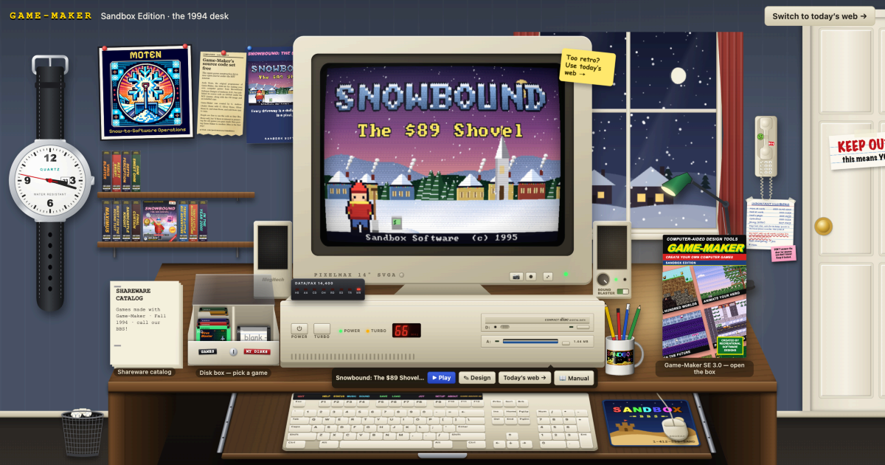
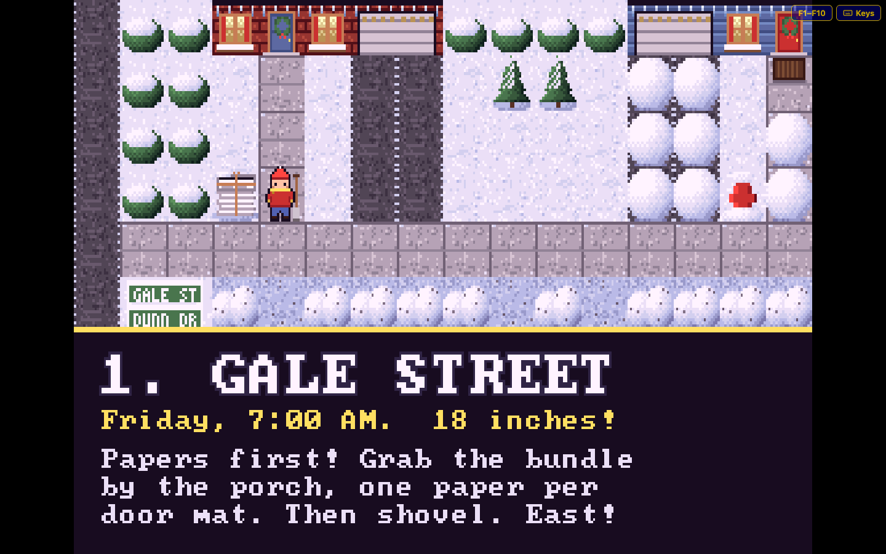
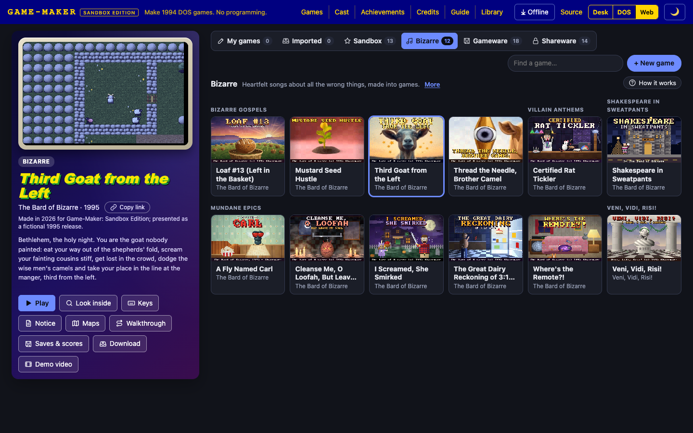

# Game-Maker: Sandbox Edition

Make and play DOS-style games in your web browser, with no programming. A modified fork of
**RSD Game-Maker 3.0**, the 1991–1995 game construction kit by Recreational Software
Designs, whose source Andy Stone released under the MIT License in 2014.

**▶ Play it: https://lewismoten.github.io/GameMaker-SandboxEdition/**



## What's in it

- **Two ways to use it:** the *1994 desk*, a recreated PC with a DOS prompt, Game-Maker's
  original menus and designers, a BBS to dial, and the games' boxes, disks and manuals on
  the shelf; or *today's web* editor with point-and-click editors for every part of a game.
- **A port, not a PC emulator:** Game-Maker and its PLAYGAME player are re-implemented in
  TypeScript from the released C source, and no DOS or x86 code runs. The desk's PC is a
  simulation; some hardware is emulated (VGA mode 13h, the OPL2 FM sound chip).
- **Original file formats:** games are read and written byte for byte as `.GAM`, `.MAP`,
  `.BBL`, `.MON`, `.CHR`, `.CMF`, `.FLI` and the rest, so a game made here still runs in DOS
  Game-Maker and DOSBox, and old games open here unchanged.
- **The CD's games:** the sample "gameware" (edit a copy) and the shareware (play only,
  with their authors' notices). CD games that shipped without a title demo get one recorded
  for this edition, kept apart from their original files.
- **Twelve new Sandbox Software games** built for this fork, entirely in code
  ([games/](games)): Maximus: The Hundred Worlds, Sandcastle Knight, Snowbound: The $89
  Shovel, In The Year 2000!, Teddy's Little Big Adventure, Teddy's Little Bigger Adventure,
  Ohm Sweet Ohm, Virus Blaster, Final Curtain, KEEP IT BRIEF! The Tiny Pockets Library,
  Depth Perception and Quest for the Round Tuit. Each comes with a manual, box art,
  printable extras and hidden felt eggs to find.
- **Twelve "bizarre" games**, also built in code from Lewis's own comic songs and
  monologues, dressed as 1995 shareware from The Sofa BBS: eleven by The Bard of Bizarre
  (Third Goat from the Left, Mustard Seed Hustle, Thread the Needle, Brother Camel, Loaf
  #13, Certified Rat Tickler, Where's the Remote?!, A Fly Named Carl, The Great Dairy
  Reckoning of 3:17 A.M., Cleanse Me, O Loofah, But Leave My Soul, I Screamed, She Smirked,
  and Shakespeare in Sweatpants) and Veni, Vidi, Risi! by Lewis's group of that name. Their
  FM music is arranged from the songs' recordings, and they are free to share.
- **The cast** ([#/cast](https://lewismoten.github.io/GameMaker-SandboxEdition/#/cast)):
  the characters who turn up in more than one of the new games, walking on with their own
  game sprites.
- **Demos and walkthroughs:** title demos play with Sound Blaster music, the PC speaker or
  no sound, and every new game has a walkthrough that plays it from power-on to the
  credits on the real engine, with chapters, ready to download as an MP4.
- **The desk PC's utilities:** HEXEDIT, BACKUP, SAVEHACK and GMCRACK, in 1990s dress but
  mainly for looking inside game files, saved games and registration while debugging.
- **Sharing:** export a game as a one-page web game, an installable web app, or a folder
  that runs in DOSBox, or download any game, your own too, as a Mac app, a Windows program
  or a Linux folder that plays offline in its own window (built in the browser; see the
  [Mac](mac/README.md), [Windows](win/README.md) and [Linux](linux/README.md) notes).
  Everything is saved in your browser and works offline.

## Screenshots

| | |
| --- | --- |
|  |  |
| The home page's Sandbox games | Editing Snowbound's neighborhood map |
|  |  |
| Playing Snowbound | The Bizarre games |

## Run it yourself

You need [Node.js](https://nodejs.org/) 22 or later.

```sh
cd web
npm install
npm run dev        # http://localhost:5173
npm test           # the test suite (vitest)
npm run typecheck  # tsc --noEmit
npm run build      # typecheck, then the static site in web/dist
npm run format     # Prettier (config at the repo root)
npm run lint       # ESLint
```

The repository was reformatted with Prettier in a few big commits. They are listed in
[`.git-blame-ignore-revs`](.git-blame-ignore-revs), which GitHub's blame view already skips.
To make `git blame` on your own computer skip them too, run this once in your clone:

```sh
git config blame.ignoreRevsFile .git-blame-ignore-revs
```

The new games are rebuilt from their code, also from `web/`:

```sh
npx vite-node ../games/teddy/build.ts             # rebuild games/teddy/disk
npx vite-node ../games/teddy/tools/check.ts       # play-test it headlessly
npx vite-node scripts/macDmg.ts teddy             # a Mac .dmg of it, in ../dist/mac
npx vite-node scripts/winExe.ts teddy             # a Windows .exe, in ../dist/win
npx vite-node scripts/linuxTar.ts teddy           # a Linux .tar.gz, in ../dist/linux
```

Pushes to `master` are published to GitHub Pages by
[`.github/workflows/pages.yml`](.github/workflows/pages.yml). The `mac-dmg`, `win-exe` and
`linux-tar` workflows build every game for each system and attach them to a GitHub release.

## Where things are

| Folder | What it holds |
| --- | --- |
| [`web/`](web) | The browser app. [web/README.md](web/README.md) explains it; [web/src/README.md](web/src/README.md) maps the source. |
| [`games/`](games) | The Sandbox Software and Bard of Bizarre games, built in code, and the shared kit that builds and play-tests them. See [games/README.md](games/README.md) and [games/kit/README.md](games/kit/README.md). |
| [`mac/`](mac), [`win/`](win), [`linux/`](linux) | The small native players that a downloaded game runs in, and how they are built. See [mac/README.md](mac/README.md), [win/README.md](win/README.md) and [linux/README.md](linux/README.md). |
| `cd/` | The original Game-Maker CD image, with its sample and shareware games. |
| [`code/`](code) | The original DOS C/C++ source. See [code/README.md](code/README.md). |
| `runtime/` | A DOS `C:` drive with Game-Maker installed, for DOSBox. |

## The original DOS version

To run the original Game-Maker, install [DOSBox](https://www.dosbox.com/), start it from
the root of this repository, and type:

```
mount c runtime
c:
cd \run\gm
gm
```

To build the DOS source you also need the Borland C++ compiler, which this fork doesn't
include, nor the Borland and Creative library files it links (none are covered by the
MIT License; NOTICE.md lists them). Copy the `tools/` folder and those files from the
[original 2014 repository](https://github.com/gandrewstone/GameMaker) into this one, then,
following Andy Stone's original notes, in DOSBox:

```
c:
dev.bat          (mounts the compiler as T: and the source as D:)
d:
cd gm
del *.obj
del *.exe
creatall         (or "create palchos", "create blocedit"… for one program)
```

## Learn more

- [Game-Maker on Wikipedia](https://en.wikipedia.org/wiki/Game-Maker)
- ["RSD GameMaker"](https://effluviaofascatteredmind.blogspot.com/2011/06/rsd-gamemaker.html),
  Andy Stone looking back on it in 2011: building it as a teenager with his family, and
  leaving every game open in the editors so players could learn from and remix each other's work
- [The Game-Maker wiki (archived)](https://web.archive.org/web/20260807223841/https://aderack.com/game-maker/index.php?title=Main_Page)
- [The original 2014 source release](https://github.com/gandrewstone/GameMaker)

## Credits and license

RSD Game-Maker was created by G. Andrew Stone, G. Oliver Stone, Oliver Stone Jr. and Joan
Stone. This fork is by Lewis Moten; the web port was written with Claude Opus 5.5, with AI
assistance doing most of the porting and code generation. The Bard of Bizarre songs'
lyrics were shaped with ChatGPT from Lewis's prompts and their music made with Riffusion
(now Google Flow Music). The CD's games belong to their authors. See [NOTICE.md](NOTICE.md) for full credits, the story behind this fork and
third-party trademarks.

Released under the [MIT License](LICENSE).
