# A tour of the web editor

_Today's web_ is the point-and-click side of Game-Maker: Sandbox Edition. Each part of a game
has its own editor, and every one reads and writes the same files DOS Game-Maker 3.0 did
(`.GAM`, `.PAL`, `.BBL`, `.MON`, `.CHR`, `.MAP`, `.SND` and the rest), so what you make here
still plays in DOSBox. Where DOS had a designer program for a job (PALCHOS, BLOCEDIT, MONEDIT,
MAPMAKER, CHAREDIT, IMAGE, SNDEDIT, GRATOR), the web editor does the same job in a browser
window, and a few jobs DOS left to other programs (music, animations, digital sounds) have an
editor here too.

These older pictures were taken in a copy of _Snowbound: The $89 Shovel_, at 1440 × 900 in the dark
theme. Some are cropped to the part that matters; layouts and controls have changed since
they were taken. The text describes the current editor.

- [The home page and your games](#the-home-page-and-your-games)
- [Make a first level](#make-a-first-level)
- [Opening a copy of a Sandbox game](#opening-a-copy-of-a-sandbox-game)
- [Overview and file galleries](#overview-and-file-galleries)
- [The map editor](#the-map-editor)
- [Play Game and Play Level](#play-game-and-play-level)
- [Blocks](#blocks)
- [Monsters and their paths](#monsters-and-their-paths)
- [The hero's sequences](#the-heros-sequences)
- [Palettes](#palettes)
- [Music](#music)
- [Sound sets and digital sounds](#sound-sets-and-digital-sounds)
- [Animations, slide shows, backdrops and text screens](#animations-slide-shows-backdrops-and-text-screens)
- [The Integrator and the DOS player](#the-integrator-and-the-dos-player)
- [The Level check and Make a walkthrough](#the-level-check-and-make-a-walkthrough)
- [Downloads](#downloads)
- [Imports, ratings and notes](#imports-ratings-and-notes)
- [The Library and the printables](#the-library-and-the-printables)
- [The Assistant and the MCP server](#the-assistant-and-the-mcp-server)

## The home page and your games

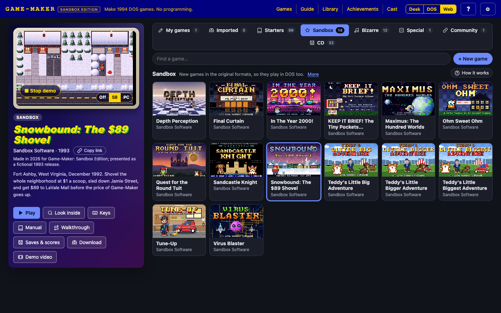

The home page groups games in tabs: **My games**, **Imported**, **Starters**, **Sandbox**,
**Bizarre**, **Special**, **Community** and **CD** (Gameware and Shareware together).
**Special** shows games while they are available, plus any you have kept by playing, looking
inside or copying them. Picking one plays its title demo in the side panel, with
Play, Look inside, Keys, the manual, the walkthrough, saves and scores, and Download beside it.
_+ New game_ starts a game ready to play or an empty one, or, with _✦ Describe it to your AI…_,
has your own AI build one from a few lines of description (see
[the Assistant](#the-assistant-and-the-mcp-server)).

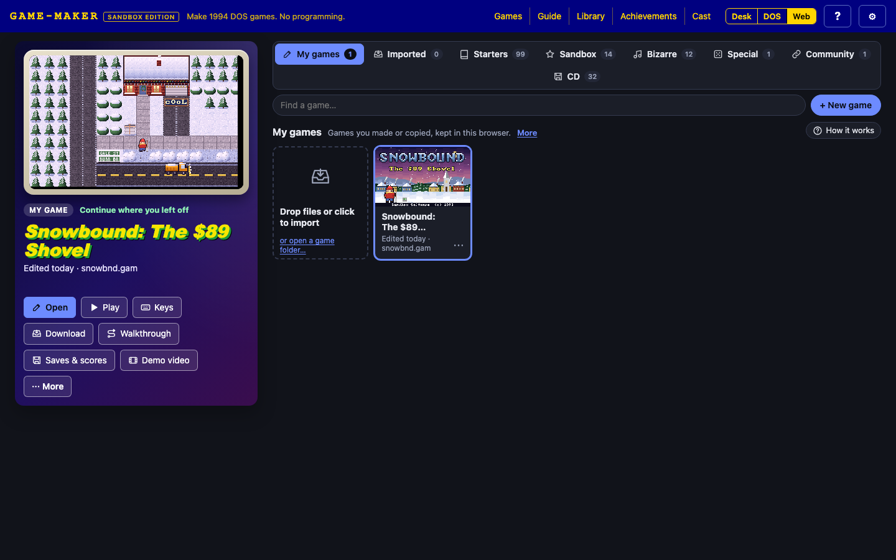

Games you make or copy are kept in this browser under _My games_, newest first, and the side
panel offers to pick up where you left off. Changes save automatically; the editor shows
**Unsaved changes…** and **Saving…** until they are saved, or **Not saved. Download a .zip**
if saving fails. Nothing is uploaded, unless you set up your own AI to work on a game.

## Make a first level

Choose _+ New game_, give it a title, then choose _▶ Ready to play_. It starts with a first
level containing scenery, monsters, a hero and sounds from the CD library, ready to change.

1. Press _▶ Play Game_ to see the starter. Escape or _Stop_ returns to the editor.
2. Open _🎓 First steps_ beside _Play Game_. Its ten small jobs take you through changing a
   color, drawing a block, building the level, changing the hero and a monster, adding a sound,
   making a way to win and a Game won screen, then running the Level check. Each job ticks itself
   when it is done and opens the file where you do it.
3. In the map, press _🩺 Level check_ before sharing the game. It plays the level and points out
   traps and dead ends it can find.

The Play screen offers **Show setup on first run**. With it checked, a game without saved
hardware choices opens video/audio setup before playing. Choose Sound Blaster for music and
digital sound, or PC speaker only for effects without music, and save the choices for that
game. **Bypass setup** (or Escape) skips the panel for this launch; unticking its checkbox
bypasses setup for other unconfigured games too. **Video & audio…** on the Play screen opens
it again whenever needed. Both VGA choices use the browser's 320 × 200 renderer. Previews,
walkthrough playback and recording do not stop for setup. Preferences backups include these
choices; play testing keeps native project files unchanged.

To keep it safe or take it to another browser, _⚙ Settings › Back up / restore…_ saves
everything this browser keeps to one `.gmbackup` file: your games, saves and high scores,
achievements, score trophies, eggs and tin hearts, the 1994 desk, imported games' notes and
ratings (never the imported games themselves), preferences and the AI setup (its key only if you
tick it). Untick any part to leave it out. _Restore from a file…_ shows what the file holds and
what each part would change, and asks one question for every part (each can be set on its own
too): _Merge_ (nothing found is lost, the higher score stays, a save slot filled on both sides
keeps yours and puts the other in Save backups), _Prefer the file_ or _Prefer this browser_
(merge, with that side winning wherever both differ), or _Replace what's here_. A part the file
doesn't have is never touched.

## Opening a copy of a Sandbox game

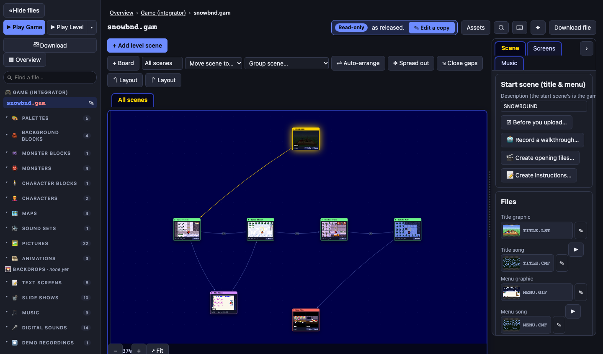

_Look inside_ opens a game exactly as it was released, read-only, so you can see how it was put
together without changing it. _Edit a copy_ makes your own copy under My games, which every
editor can then change. The file list on the left is grouped the way Game-Maker's menus were:
palettes, block sets, monsters, characters, maps, sound sets, pictures and so on.

## Overview and file galleries

A game opens on its **Overview**, with four tabs: **Files**, **Controls**, **DOS player** and **Tools**.
The address keeps the tab (`?tab=controls`), so Back, Forward and a reload return to it.

**Tools** has a **Game version** card: type a version such as `1.0` and tick **Show the version on the
title menu** to letter it (`v1.0`) in the lower right of the menu picture, so players can tell which
version they have. It is off until you tick it, and the picture beside it is the real menu with the
stamp. Only Play, play tests and downloads get the stamped picture; your game files stay as they are.

**Files** is the asset browser. Each file type has a preview and a file count;
_None yet_ marks an empty category. Choose a category to see its files, then click a thumbnail
to open its editor. The breadcrumb above an open file returns to its category or **Overview**;
**← All assets** returns from a category to the full gallery. Back and Forward keep these views too.

The **Search this game** box above the thumbnails looks through everything at once, ignoring
case, and shows what it finds as cards grouped by kind, with a count for each: **File names**;
**Words inside files** (text screens, slide lists, the game file's scene names, high-score
names, digital sound names and backdrops), with the matching words marked under the thumbnail;
**Companion notes and names** (the key, joystick, counter and sound names from Controls, and any
other note the editor keeps for the game); and **DOS player fields**, each a small card with the
field's name and value that matches its name, its stock text or what it is set to now. A card
opens that file, the Controls tab, or the DOS player tab on that field. Arrow keys move between
cards, Enter opens one, and Escape clears the box. It also works on look-only games. The sidebar's
**Find a file** box still filters file names only.

**Controls** is where you say what the game's controls mean, once for every character: a short
and a long description for each key the game uses (the editor works out what each key does and
shows it beside your words), for joystick buttons 1 and 2, and a name for each of the 15
repetition counters and 5 hidden counters, with where each is used. The character editor, the
block editor, the **Keys** dialog and the Saves panel show these words. They are only for the
editor: the DOS files never change. **Undo** and **Redo** work here too.

**DOS player** is the stand-alone player's panel, described under
[The Integrator and the DOS player](#the-integrator-and-the-dos-player). The Integrator's
**DOS player** button opens this tab.

Beside the preview, the **Patch Lab** strip shows the setting being edited as bytes: the file offset in `XFERPLAY.EXE`, the CD's own bytes and the new ones, with the changed bytes in bold, underlined and boxed (so color is never the only cue). It is read-only and scrolls sideways inside its own box. The Programmer's Guide chapter "Patching the player" explains the bytes.

**Tools** gathers the tools that work on the whole game, one card each, with a picture or what is
known now and a button that opens it: **Level check** (a picture of the first level, how many levels have
a saved check and what it found), **Before You Upload** (lines ticked), **Make a walkthrough**
(whether one was made and how far it got), **Health check** (reads every file and lists the
broken ones), **First steps** (in games started from the starter), **Color vision check** (the
palette, drawn), **Optimize**, **Game version**, **About this game**, **Play Game** and **Download**. The status comes from what is already saved;
opening the tab never runs a check. Each tool also opens from where it always did.

Reserved ranges are optional and are never enforced. Colors in no range are global, any kind of art may use them, and color 0 (the background color) and 255 (transparency) are always fine. With ranges set, the Level check suggests a look at a block that draws with a color reserved for another kind (a character block using a monster color, say); dismiss it if it is on purpose. The block editors also say so, in the note under the color swatches, when you pick a color reserved for another kind; painting is never blocked.

If you have reserved palette ranges for backgrounds, monsters and characters (Palette editor), Optimize also lists block files that draw with colors reserved for another kind. **Apply** moves those pixels to the nearest allowed color, after showing each changed block before and after with a difference score (CIELAB delta E; large changes are flagged). It is separate from the automatic steps because it changes how the game looks.

**Pack with reserved palettes** (the **Look for more savings** button) goes further: it uses your reserved ranges, or proposes a range for monsters and for characters when there are none, moves each file's colors into them, then looks for monster, character and background files that can join. It shows the bytes it would save, how many map pixels would draw differently and the delta E, and applies it all in one click and one Undo; it is offered only when it frees more than the automatic steps. When blocks join or fold, the names and groups you gave them follow.

**Optimize** also holds your **checkpoints**: stamps of the whole game (every file and its editor
notes), made with **Make a checkpoint…** any time and always before an optimization is applied. Each
stores only what changed since the one before, the way a git repository does: a changed block or map
cell is a few bytes, a changed text file a few lines. **Compare…** lists what changed and draws each
level's map as it was and as it is (Before, After or side by side, with a jump to the next view that
differs). **Play…** runs the game as that stamp stored it in the web player, nothing saved. **Restore** puts everything back (Undo takes the files back), **Tag release…** labels a stamp as a
release, and **Delete** removes one (the later stamps keep everything they had). They stay with the game
in this browser and in a browser backup (tick _Leave out checkpoints_ in the backup dialog for a shallow
copy), never in a download or a DOS export.

**Blocks that look the same** (also in Optimize) lists, per block set, blocks that are drawn the same
colors in every palette the set is shown with and play the same, each with a picture and how many
map cells use it, plus blocks of one shape in other colors, which stay as they are. Blocks that look the same (same colors under every palette, same rules) can be joined into one, with the maps following; this frees slots and changes no scene. Joining two block sets into one file (the dropped set's blocks move into the other's free slots and its maps follow) is one of the merges Disk space offers; every scene is drawn the same afterward.

The first card adds files. **Add a file…** offers new files, the Library, uploads and the
available converters. **From this game…** makes a copy of an existing file. Copy a file, open
another project in this browser tab, then use **Paste** in the matching category. Block groups
and other settings belonging to the copied file follow it.

Right-click a file or choose its **⋯** button for **Edit**, **Duplicate…**, **Copy**,
**Paste to replace…**, **Delete…** and **Download**. The menu also opens with Shift+F10; use the arrow keys and Escape.
Replacing a file keeps its name and asks for confirmation. **Download** saves the file's current
native bytes.

The Library file picker separates **Starters** from **Sandbox & Bizarre** and lets you filter
by source game as well as file name.

Drop matching native files on the first card to add several at once. Existing names get new
DOS names, so a dropped file is added alongside the one already there.

## The map editor

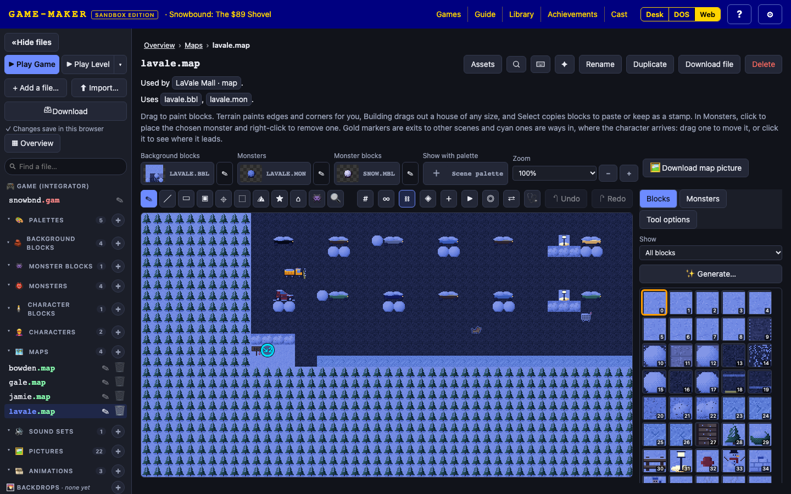

Maps are 100 × 100 blocks, as in MAPMAKER. Paint background blocks, drag out rectangles or
whole houses, and place monsters from the pickers on the right. Gold markers are the exits to
other scenes and cyan ones are where the hero arrives; drag one to move it. Any palette can be
shown over the map to see it by night or at dusk, and _Download map picture_ saves the whole map
as a PNG.

**Wrap** (∞) keeps scrolling through any edge to the opposite side. All the visible copies
edit the same map, including selections, pasted blocks and terrain brushes. Use Shift+wheel
or the focused map's arrow keys to scroll; on a touch screen, choose **Scroll** before dragging.
Pinch with two fingers to zoom, or move them together to pan, with any tool chosen. Hold one
finger still to open **Map actions**, with **Pick this block** and, where available,
**Erase monster** or **Use as the exit's place**. The Wrap preference is remembered and
included in preference backups.

In the **Blocks** panel, **Show** (named **Show blocks used as** for screen readers) filters
the palette by roles marked in the block editor's **Uses** tab. **All blocks** restores the
whole set; **No role set** finds unmarked blocks. The filter appears only when roles are set.

**✨ Generate…** opens **Generate a layout** in the Blocks panel. Choose a dungeon, castle,
forest, home, shop, town, overworld or platform side view, made from those marked blocks.
It shows four real previews from a seed, for the whole map or a rectangular selection;
**Use this layout** draws the chosen one in a single Undo step. Missing roles link to the
Uses tab, and terrain brushes supply edges and corners where available. Platform layouts
use the hero's own jump and a difficulty slider; previews say **Jump math**, **Bot won** or
**Not proven**. These checks do not judge monsters or fun.

Layouts suggest a start and exits. Where doors or sites are proposed, **Make these scenes…** can also
create maps and scenes for eligible doors or sites, with links both ways; the confirmation
explains that Undo takes back the layout, while added scenes must be removed in the Integrator.
**Add monsters (replaces those in the area)** optionally places monsters for layouts that
support them; if the DOS placement slots fill up, the editor reports those left out.

## Play Game and Play Level

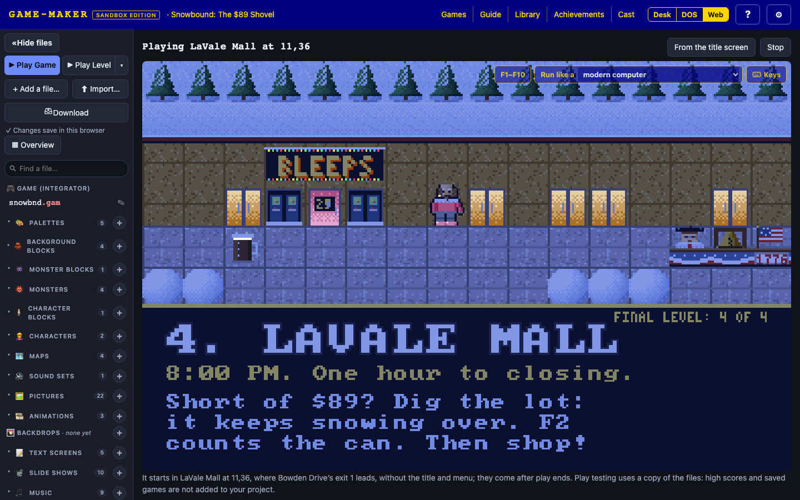

_Play Game_ plays the whole game from its title screen, as PLAYGAME would. _Play Level_ starts
straight in the open map, at the exit that leads there (or a start you choose from its menu),
skipping the title and menu. Play tests run on a copy of the files, so high scores and saved
games don't end up in your project.

## Blocks

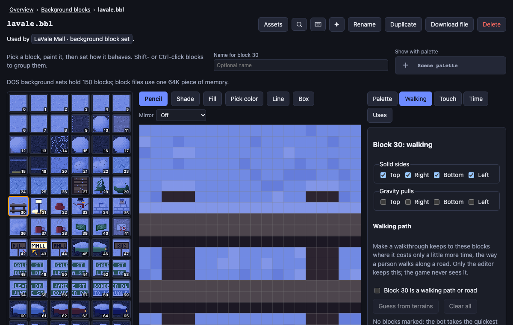

The block editor is BLOCEDIT: pick a block, draw it with the pencil, shading, fill and lines,
then say how it behaves in **Walking**, **Touch** and **Time**: which sides are solid, which
way gravity pulls, whether it can be picked up. The picker explains the fixed DOS capacities:
150 background blocks, 100 monster blocks or 50 hero blocks per set.
Shift- or Ctrl-click several blocks to group them and change them together. Flip, rotate,
shift and _Make an edge set…_ save a lot of drawing.
The **Uses** tab marks what a block is for (wall, door, key, chair facing south...) with chips; the editor suggests some from what the block does, and you tap to keep them. They are saved with the project, never in the game's files.

## Monsters and their paths

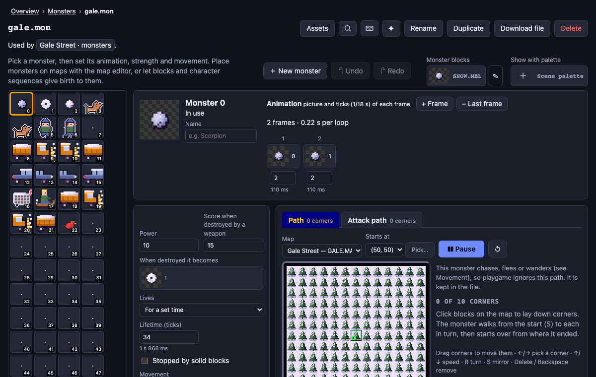

As in MONEDIT, each monster has its animation, its power and score, what it becomes when
destroyed, and how it moves. Its path and attack path are drawn right on the map it lives in:
click to lay down corners and drag them to move them, and watch it walk the path as you go.
Unused slots show no active monster; retained frames are labeled as template data.
**＋ New monster** explains when every DOS monster slot is already in use.

## The hero's sequences

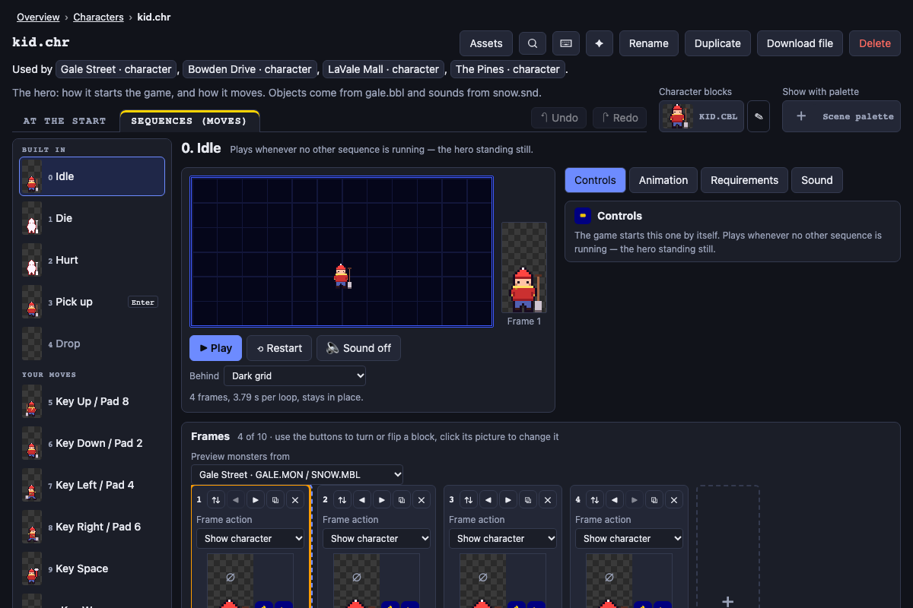

The character editor is CHAREDIT. _At the start_ sets the hero's hit points, lives, money,
counters and starting inventory. _Sequences (moves)_ is how it moves: one sequence per key or event
(idle, die, hurt, pick up, the arrow keys, Space and the rest), each a row of frames with how far
the hero moves and for how many ticks.

## Palettes

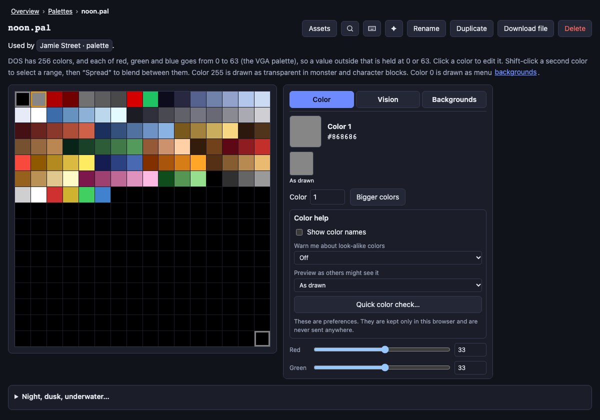

A palette is 256 colors, as in PALCHOS. Click a color to change it, Shift-click a second to
pick a range, then spread a blend between them or make a shade ramp. Two colors are special,
as they were in DOS: color 255 is drawn as see-through in monster and character blocks, and
color 0 is the background of PLAYGAME's menus. The panel below lists the blocks that use each
color, so you can see what a change will touch. **Color**, **Vision** and **Backgrounds**
split color editing, color-vision previews and menu background previews into tabs.

**Color help** (a small control in the palette editor and in the block, monster and character
painters) holds three choices, kept only in your browser: **Show color names** adds each color's plain name ("dark
red", "light blue-green") on its swatch and on the selected color's line; **Warn me about look-alike colors** marks colors that
look alike to some eyes, red and green or blue and yellow, with dashed outlines in the palette and
a note when two such colors touch in a picture you are painting; and **Preview as others might see it**
shows the color or picture side by side. An optional **Quick color check…** (a few "which tile looks
different?" screens) only suggests which of these to turn on. It is not a medical test and keeps
no answers.

## Music

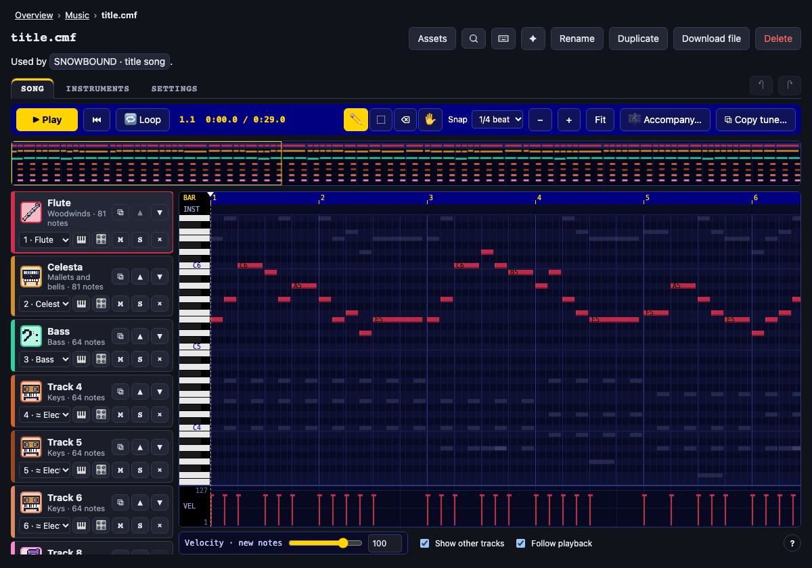

Game-Maker played `.CMF` songs on the Sound Blaster's FM chip but never had a way to write them;
in 1994 that took another program. Here the music editor is a piano roll: tracks with FM
instruments, notes to draw and drag, loops and snapping, and playback on an emulated OPL2 chip.
It saves a real `.CMF` that the DOS player plays.

## Sound sets and digital sounds

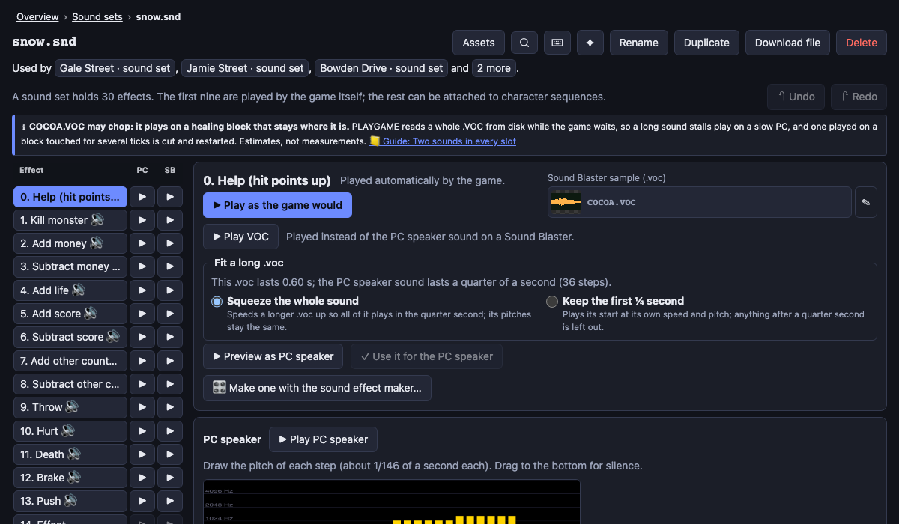

A sound set (`.SND`, from SNDEDIT) holds 30 effects. The first nine are played by the game
itself (hit points up, kill a monster, add money and so on); the rest can be tied to the hero's
sequences. Each has a PC speaker version, drawn as a row of pitches, and can have a Sound
Blaster `.VOC` sample instead.

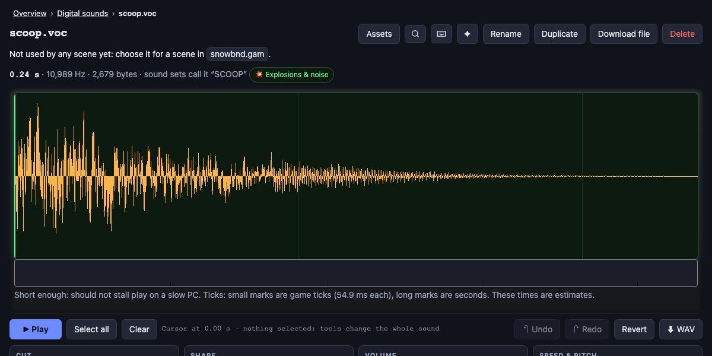

The `.VOC` editor trims, fades, normalizes, reverses and changes the speed and pitch of a
sample, or records a new one from the microphone. It saves 8-bit sound, the way the Sound
Blaster played it.
Under the waveform a time ruler marks seconds and game ticks, with a yellow zone where a slow PC may stutter and a red zone where it likely will, and a line at 64 KB. DOS reads the whole sound from disk while the game waits, so the zones are estimates from old hard-disk speeds. The sound still records and plays in full; the ruler is only a warning.

## Animations, slide shows, backdrops and text screens

The picture editor opens `.GIF` files, replaces them with imported art and copies selected
20 × 20 regions into blocks, keeping the blocks' other settings.

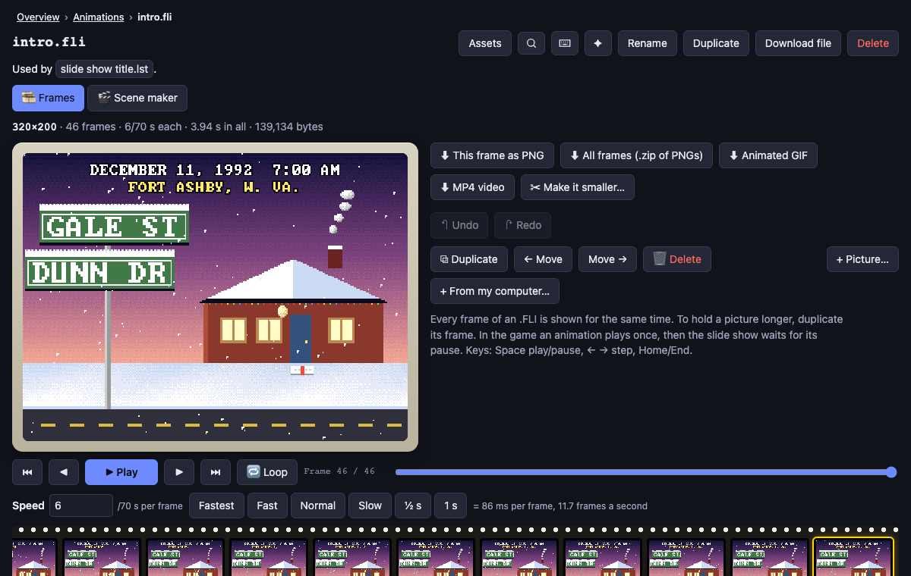

Game-Maker showed `.FLI` animations between scenes, made in Autodesk Animator back then. The
animation editor steps through the frames, sets the speed, duplicates, moves and replaces
frames, and exports a frame, every frame, an animated GIF or a video (MP4 where the browser
supports it, otherwise WebM). **🎬 Scene maker** builds animations from objects, paths,
a timeline and fades, keeping the editable scene with the project.

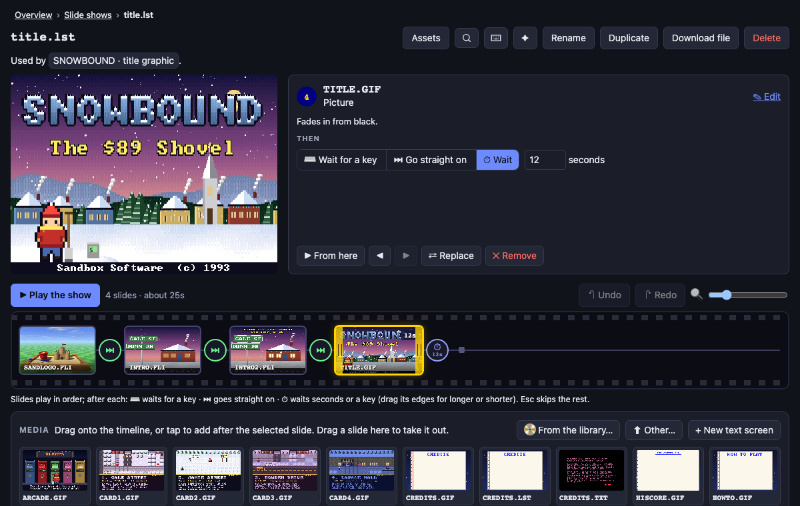

A slide list (`.LST`) is the order Game-Maker shows pictures, animations and text in, with a
wait for a key, a pause or none after each. Drag pictures onto the timeline to build one. A
backdrop (`.BKD`) is a part of a bigger picture, chosen the same way; Snowbound doesn't use any,
so none show here.

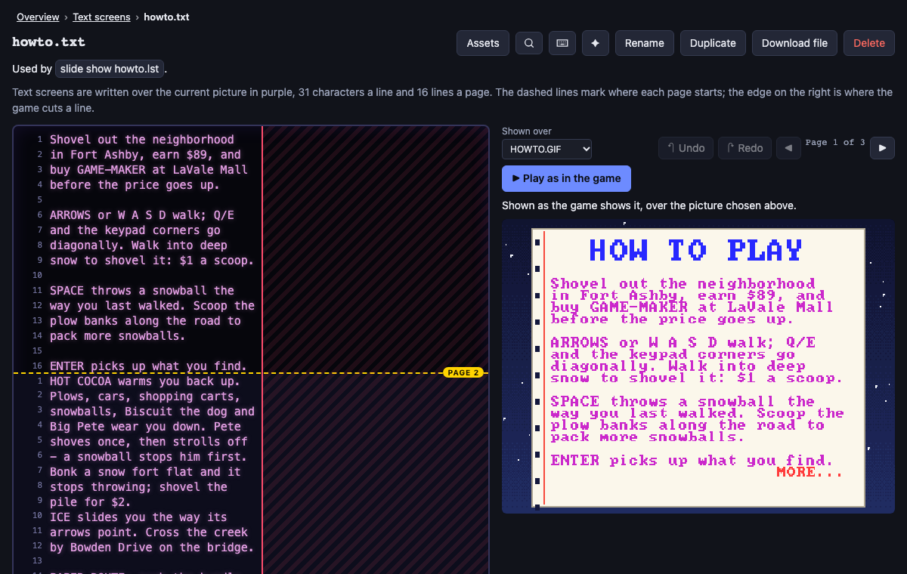

Text screens are written over their picture, 31 characters a line and 16 lines a page, as the
DOS player draws them. The preview on the right is the game's own drawing of it.

## The Integrator and the DOS player

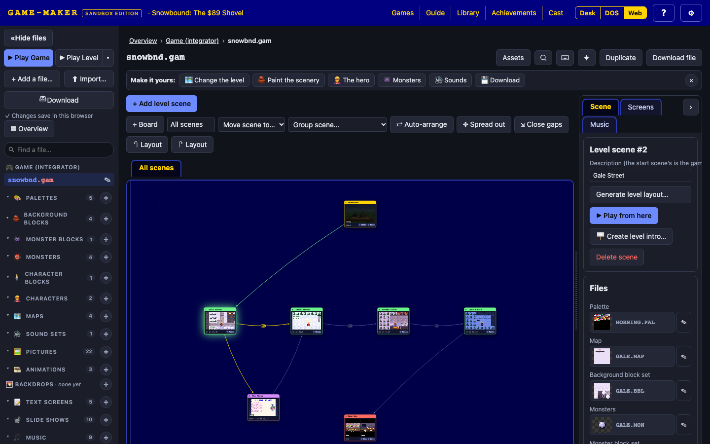

The `.GAM` file is the Integrator's (GRATOR's): every scene of the game and how they link. Here
it is a graph. Scenes can be added, arranged and joined, and the side panel lists each scene's
pictures, songs and maps, or every screen and song at once. The **Scene** tab offers
**Generate level layout…** for a level's map.

Demo recordings (`.REC`) have an editor for recording, playback and trimming, including
making a demo from a bot walkthrough. High-score tables (`.HIS`) have an editor for names
and scores, separate from the DOS player's screen layout.

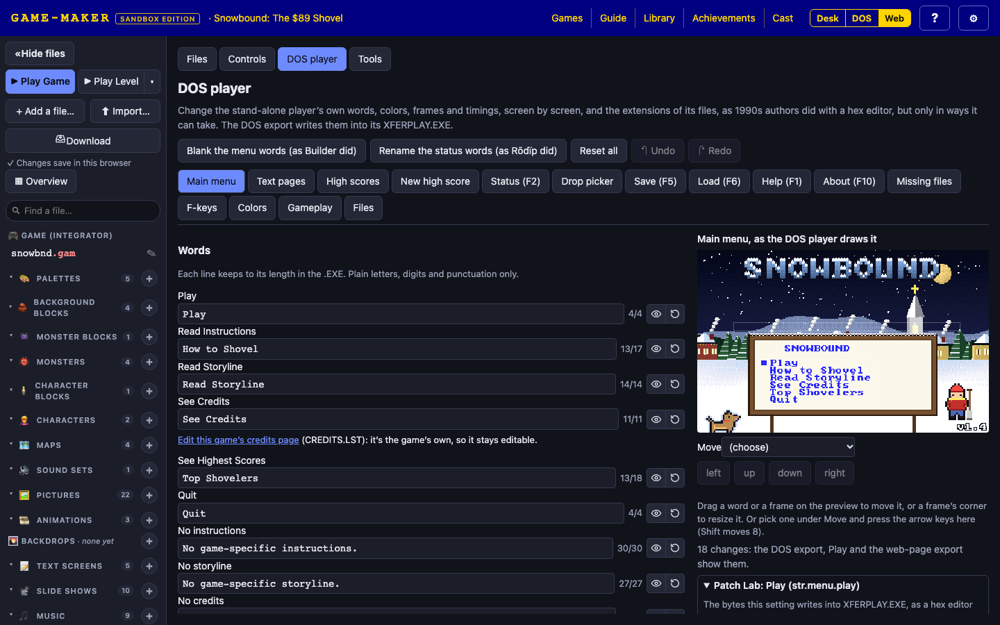

Authors in the 1990s changed the DOS player's words, colors and screens with a hex editor. The
DOS player tab of the Overview does it safely, a tab for each screen: rename or hide menu words, move or
resize a frame by dragging it on the preview, and pick colors, timings, F-keys and file
extensions. The DOS export writes the changes into its `XFERPLAY.EXE`, and Play and the web
exports show them too. The **Gameplay** tab holds settings marked **Experimental** that
change how scenes play; its warning asks you to test the patched game in DOSBox before sharing.

## The Level check and Make a walkthrough

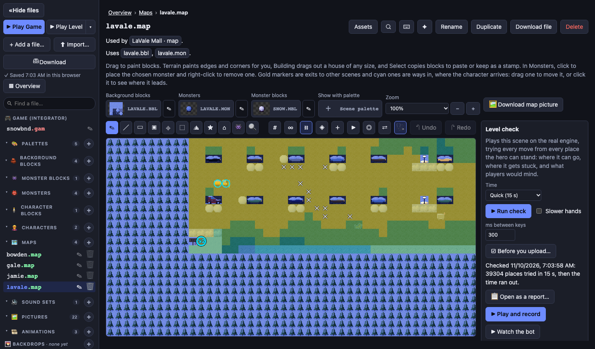

The Level check explores a scene on the real engine within the chosen time budget. The heat
map shows where the bot got, and it marks possible stuck spots, with fixes where it knows one.
These are suggestions: a timed search can miss routes, and it cannot judge whether a level is
fun. **✓ That’s on purpose** or **✓ Mark as checked: it’s meant to be** accepts a finding;
accepted findings can be shown again. The block, monster and sound editors show findings as
badges, and **☑ Before you upload…** ticks the checklist where the checks can tell.

**Slower hands** tries a pause between key changes. **▶ Play and record** adds your own play
to **My heat map**, which can be combined or compared with the bot's; an exit-reaching take
can also be kept for a walkthrough.

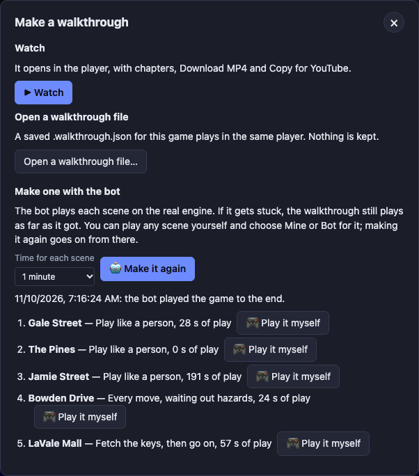

_Make a walkthrough_ sends a bot through every scene, trying quicker play styles first, and
says how far it got. Its run can be watched, or opened on the map in the Level check.
**Time for each scene** sets its budget; a partial run still plays as far as it reached.
For a scene you played and kept, choose **Mine** or **Bot**, then make the walkthrough again
to continue from there. The picture shows one run at a minute a scene, with each scene's play style and a
**Play it myself** button beside it.

## Downloads

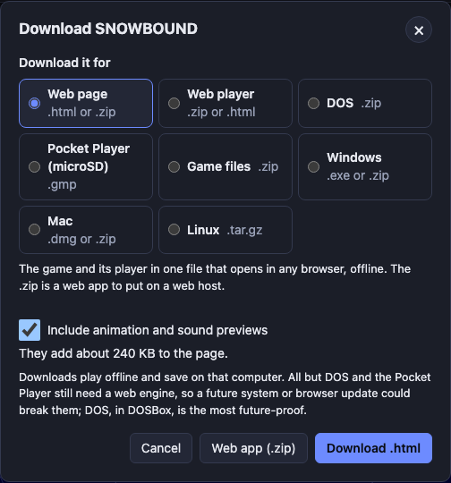

A game downloads as a Windows program, a Mac app or a Linux folder that plays in its own window;
as a one-page web game or an installable web app; as the web player for your own site; as a DOS
folder with the stand-alone player, for DOSBox or a real PC; or as **Game files** alone.
**Pocket Player (microSD)** saves one `.gmp` file for the board's microSD card, with PC speaker
sounds. Downloads from an edited game are built in the browser; a released game's DOS choice
uses its prepared ZIP.

## Imports, ratings and notes

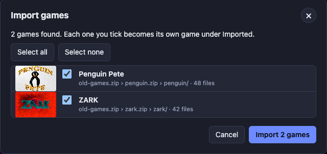

Drop folders, files, `.zip`s (zips inside zips too) or exported `.html` pages on the import
tile. Every game found inside is listed with its picture and where it came from, so a whole
archive can come in at once.

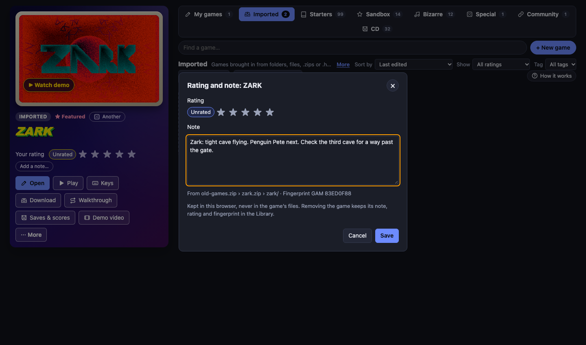

Imported games get a 1–5 star rating and a note, kept in this browser and never in the game's
files. The Library collects the notes, and a game removed and imported again gets its rating
and note back. Imported cards also show **Tags** for recognized games with curated tags, or
**Suggested tags** for the editor's guesses; the **Tag** picker filters the list.

## The Library and the printables

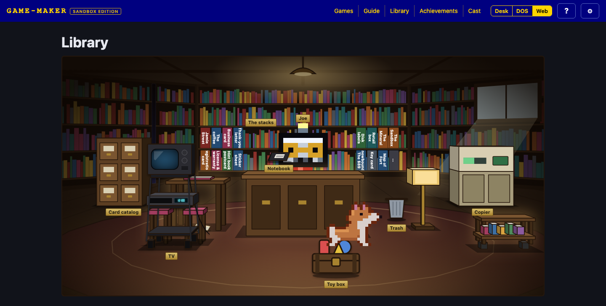

The Library holds everything to read or print: the Game-Maker guides, each game's manual,
hint book, maps, newsletter, stickers and cards, the walkthroughs and the videos. In the room,
open **Card catalog**, choose **By game** or **By type**, and open a drawer; **The stacks**
shows its contents as a list. **Copier** handles printing, **TV** gathers videos and walkthroughs,
and **Notebook** opens imported games' ratings and notes.

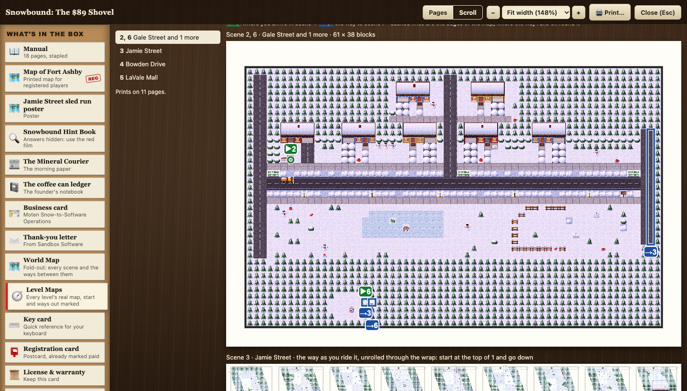

Paper opens in the box viewer, a page at a time or as one scrolling column, at any size. The
Level Maps are each level's real map, cropped to what the player sees, with the start and ways
out marked.

## The Assistant and the MCP server

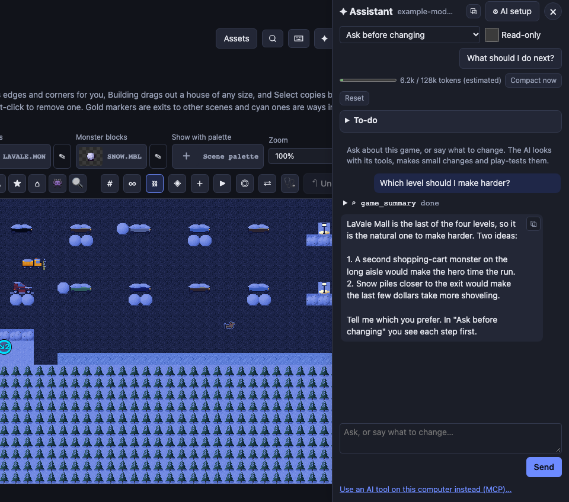

The ✦ button beside a file's title opens the Assistant, a chat with your own AI about the open
game. _AI setup_ connects it to Ollama, on this computer or another, or to any OpenAI-compatible
server; the address, model and key stay in this browser. The AI looks at the game with the same
tools the Level check and the bot use, and makes small changes and play-tests them. In _Ask
before changing_ each change waits for Apply or Skip; _Change freely (Undo still works)_ applies them with Undo
still there, and _Read-only_ keeps it to looking. _What should I do next?_ runs the Level check, the bot
and the file checks and has the AI say what to fix first (with no AI set up, it lists what the
checks found), and the game keeps a to-do list. _Describe a game…_, for an empty game here, or
_✦ Describe it to your AI…_ in the home page's _+ New game_, builds a game from a description until the bot can win it. The picture was taken with a
scripted stand-in for a model, not a real AI.

_Use an AI tool on this computer instead (MCP)…_ at the bottom of the chat connects the open game
to the Game-Maker MCP server instead (`npm run mcp -- --bridge` in `web/`), so an AI tool such as
Claude Code can work on it, each change a step you can undo. The server also works on game
folders without the editor; see [the MCP server's README](../web/scripts/mcp/README.md).
