# A tour of the web editor

_Today's web_ is the point-and-click side of Game-Maker: Sandbox Edition. Each part of a game
has its own editor, and every one reads and writes the same files DOS Game-Maker 3.0 did
(`.GAM`, `.PAL`, `.BBL`, `.MON`, `.CHR`, `.MAP`, `.SND` and the rest), so what you make here
still plays in DOSBox. Where DOS had a designer program for a job (PALCHOS, BLOCEDIT, MONEDIT,
MAPMAKER, CHAREDIT, IMAGE, SNDEDIT, GRATOR), the web editor does the same job in a browser
window, and a few jobs DOS left to other programs (music, animations, digital sounds) have an
editor here too.

These pictures were taken in a copy of _Snowbound: The $89 Shovel_, at 1440 × 900 in the dark
theme. Some are cropped to the part that matters.

- [The home page and your games](#the-home-page-and-your-games)
- [Opening a copy of a Sandbox game](#opening-a-copy-of-a-sandbox-game)
- [The map editor](#the-map-editor)
- [Play Game and Play Level](#play-game-and-play-level)
- [Blocks](#blocks)
- [Monsters and their paths](#monsters-and-their-paths)
- [The hero's sequences](#the-heros-sequences)
- [Palettes](#palettes)
- [Music](#music)
- [Sound sets and digital sounds](#sound-sets-and-digital-sounds)
- [Animations, slide shows, backdrops and text screens](#animations-slide-shows-backdrops-and-text-screens)
- [The Integrator and the DOS player](#the-integrator-and-the-dos-player)
- [The Level check and Make a walkthrough](#the-level-check-and-make-a-walkthrough)
- [Downloads](#downloads)
- [Imports, ratings and notes](#imports-ratings-and-notes)
- [The Library and the printables](#the-library-and-the-printables)
- [The Assistant and the MCP server](#the-assistant-and-the-mcp-server)

## The home page and your games

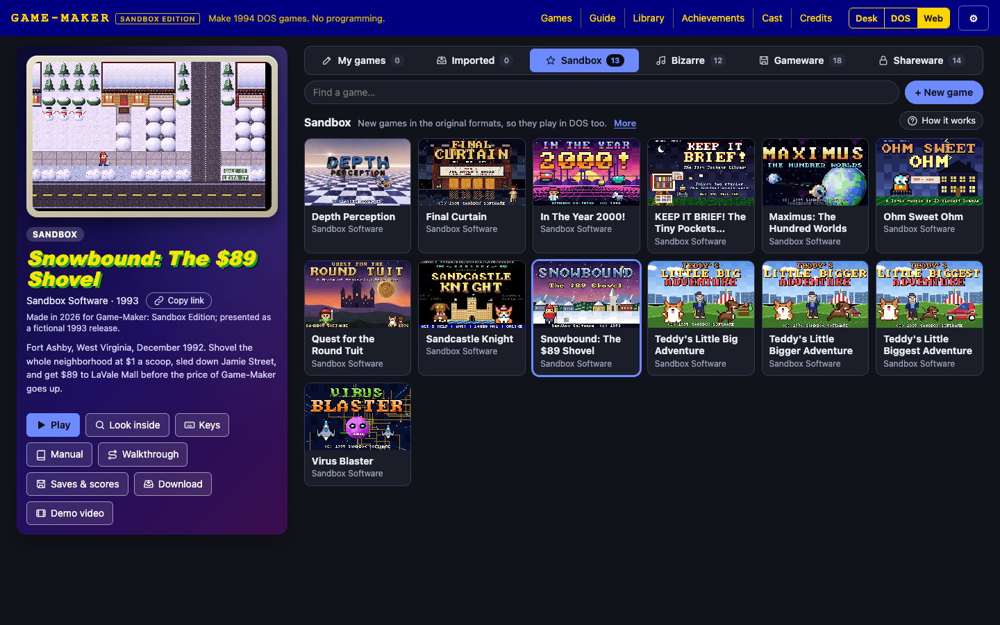

The home page lists every game by tab: _My games_, _Imported_, the Sandbox and Bizarre games,
the CD's Gameware and its Shareware. Picking one plays its title demo in the side panel, with
Play, Look inside, Keys, the manual, the walkthrough, saves and scores, and Download beside it.
_+ New game_ starts a game ready to play or an empty one, or, with _✦ Describe it to your AI…_,
has your own AI build one from a few lines of description (see
[the Assistant](#the-assistant-and-the-mcp-server)).

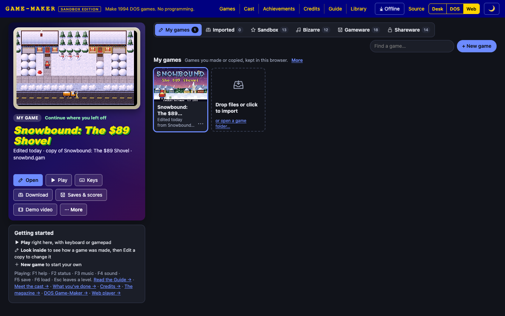

Games you make or copy are kept in this browser under _My games_, newest first, and the side
panel offers to pick up where you left off. Nothing is uploaded anywhere.

To keep it safe or take it to another browser, _⚙ Settings › Back up / restore…_ saves
everything this browser keeps to one `.gmbackup` file: your games, saves and high scores,
achievements, score trophies, eggs and tin hearts, the 1994 desk, imported games' notes and
ratings (never the imported games themselves), preferences and the AI setup (its key only if you
tick it). Untick any part to leave it out. _Restore from a file…_ shows what the file holds and
what each part would change, and asks one question for every part (each can be set on its own
too): _Merge_ (nothing found is lost, the higher score stays, a save slot filled on both sides
keeps yours and puts the other in Save backups), _Prefer the file_ or _Prefer this browser_
(merge, with that side winning wherever both differ), or _Replace what's here_. A part the file
doesn't have is never touched.

## Opening a copy of a Sandbox game

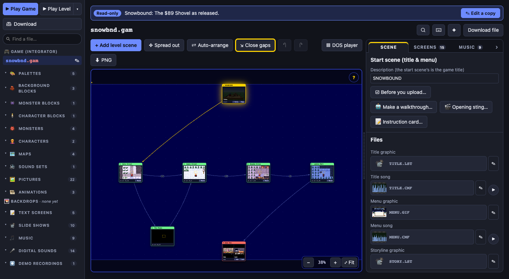

_Look inside_ opens a game exactly as it was released, read-only, so you can see how it was put
together without changing it. _Edit a copy_ makes your own copy under My games, which every
editor can then change. The file list on the left is grouped the way Game-Maker's menus were:
palettes, block sets, monsters, characters, maps, sound sets, pictures and so on.

## The map editor

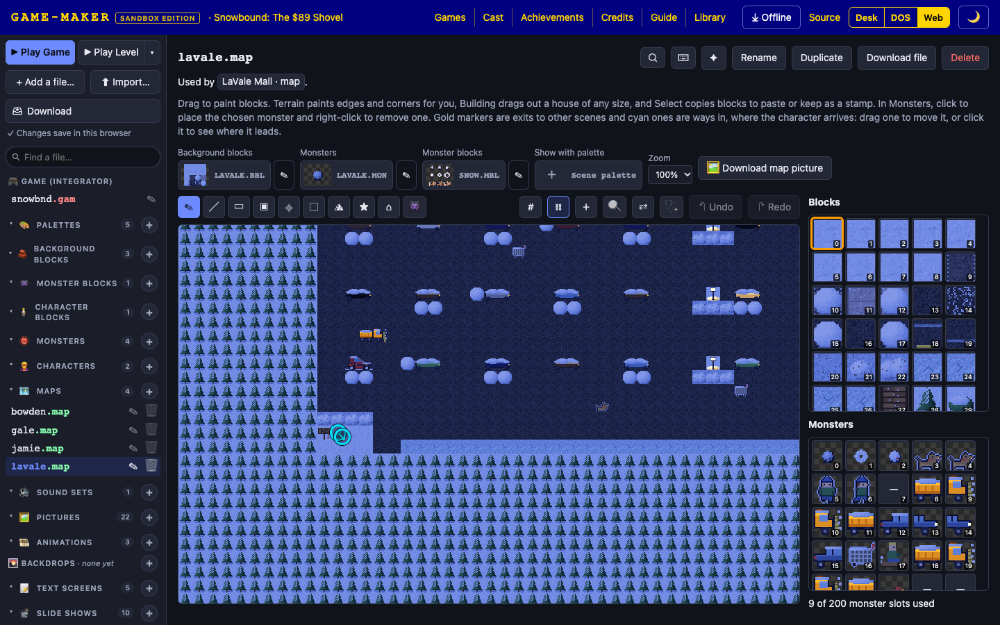

Maps are 100 × 100 blocks, as in MAPMAKER. Paint background blocks, drag out rectangles or
whole houses, and place monsters from the pickers on the right. Gold markers are the exits to
other scenes and cyan ones are where the hero arrives; drag one to move it. Any palette can be
shown over the map to see it by night or at dusk, and _Download map picture_ saves the whole map
as a PNG.

## Play Game and Play Level

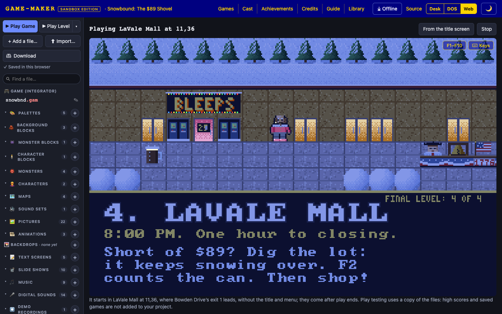

_Play Game_ plays the whole game from its title screen, as PLAYGAME would. _Play Level_ starts
straight in the open map, at the exit that leads there (or a start you choose from its menu),
skipping the title and menu. Play tests run on a copy of the files, so high scores and saved
games don't end up in your project.

## Blocks

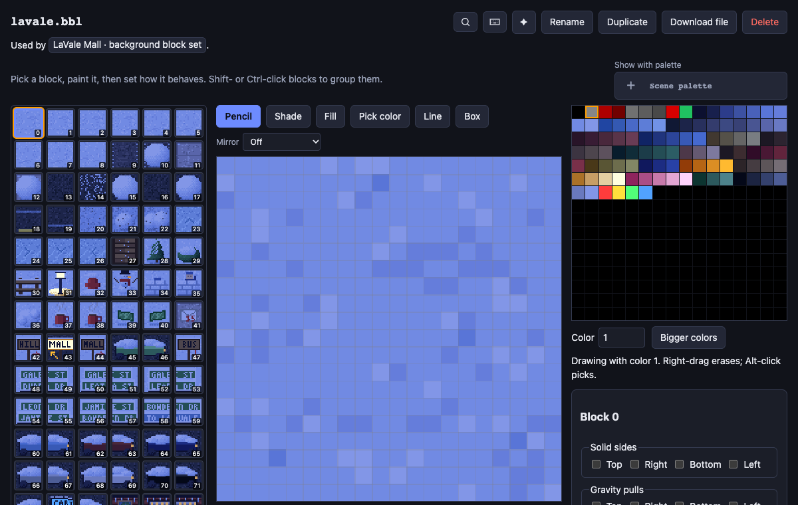

The block editor is BLOCEDIT: pick a block, draw it with the pencil, shading, fill and lines,
then say how it behaves: which sides are solid, which way gravity pulls, whether it can be picked
up.
Shift- or Ctrl-click several blocks to group them and change them together. Flip, rotate,
shift and _Make an edge set_ save a lot of drawing.

## Monsters and their paths

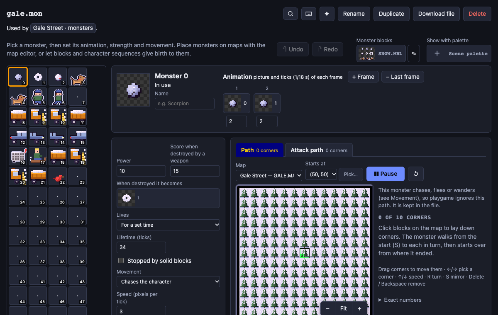

As in MONEDIT, each monster has its animation, its power and score, what it becomes when
destroyed, and how it moves. Its path and attack path are drawn right on the map it lives in:
click to lay down corners and drag them to move them, and watch it walk the path as you go.

## The hero's sequences

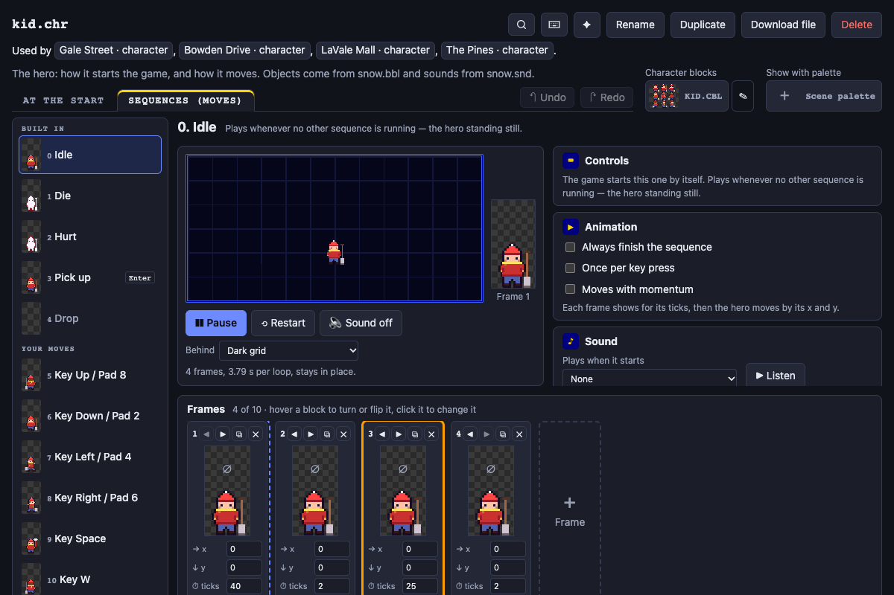

The character editor is CHAREDIT. _At the start_ sets the hero's hit points, lives, money,
counters and starting inventory. _Sequences_ is how it moves: one sequence per key or event
(idle, die, hurt, pick up, the arrow keys, Space and the rest), each a row of frames with how far
the hero moves and for how many ticks.

## Palettes

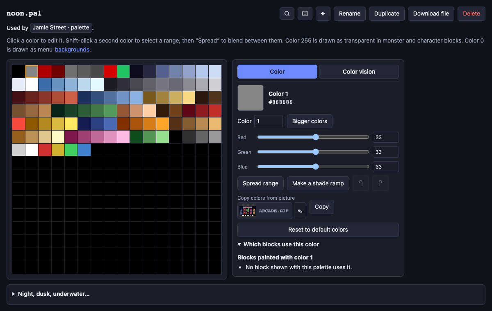

A palette is 256 colors, as in PALCHOS. Click a color to change it, Shift-click a second to
pick a range, then spread a blend between them or make a shade ramp. Two colors are special,
as they were in DOS: color 255 is drawn as see-through in monster and character blocks, and
color 0 is the background of PLAYGAME's menus. The panel below lists the blocks that use each
color, so you can see what a change will touch.

## Music

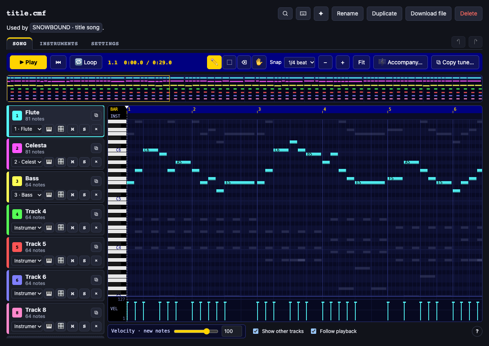

Game-Maker played `.CMF` songs on the Sound Blaster's FM chip but never had a way to write them;
in 1994 that took another program. Here the music editor is a piano roll: tracks with FM
instruments, notes to draw and drag, loops and snapping, and playback on an emulated OPL2 chip.
It saves a real `.CMF` that the DOS player plays.

## Sound sets and digital sounds

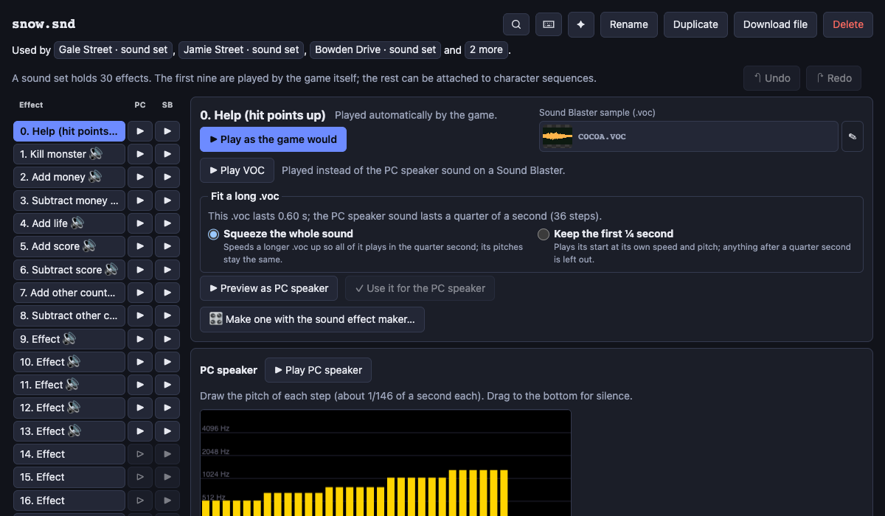

A sound set (`.SND`, from SNDEDIT) holds 30 effects. The first nine are played by the game
itself (hit points up, kill a monster, add money and so on); the rest can be tied to the hero's
sequences. Each has a PC speaker version, drawn as a row of pitches, and can have a Sound
Blaster `.VOC` sample instead.

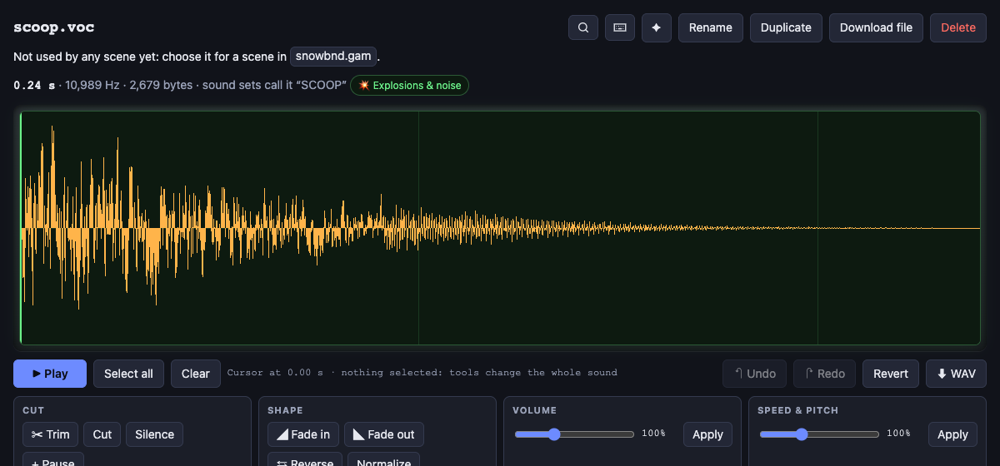

The `.VOC` editor trims, fades, normalizes, reverses and changes the speed and pitch of a
sample, or records a new one from the microphone. It saves 8-bit sound, the way the Sound
Blaster played it.

## Animations, slide shows, backdrops and text screens

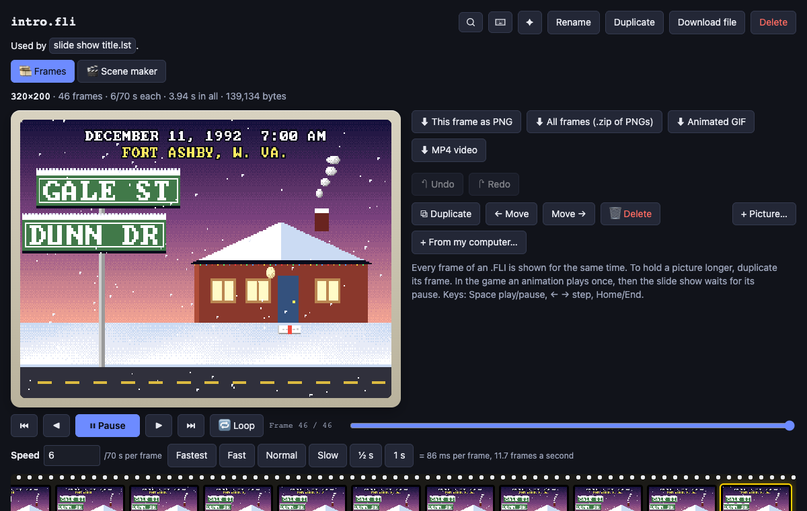

Game-Maker showed `.FLI` animations between scenes, made in Autodesk Animator back then. The
animation editor steps through the frames, sets the speed, duplicates, moves and replaces
frames, and exports a frame, every frame, an animated GIF or an MP4.

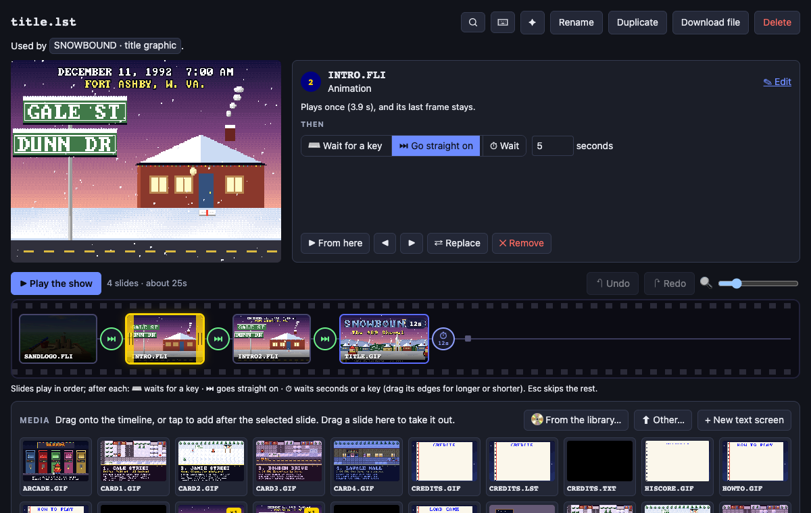

A slide list (`.LST`) is the order Game-Maker shows pictures, animations and text in, with a
wait for a key, a pause or none after each. Drag pictures onto the timeline to build one. A
backdrop (`.BKD`) is a part of a bigger picture, chosen the same way; Snowbound doesn't use any,
so none show here.

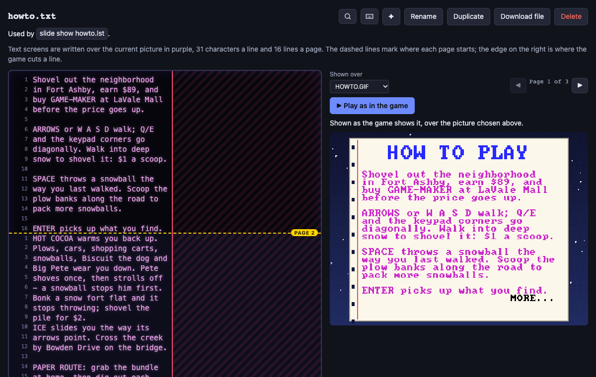

Text screens are written over their picture, 31 characters a line and 16 lines a page, as the
DOS player draws them. The preview on the right is the game's own drawing of it.

## The Integrator and the DOS player

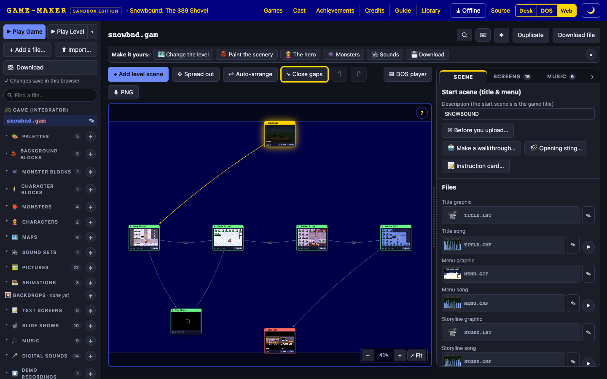

The `.GAM` file is the Integrator's (GRATOR's): every scene of the game and how they link. Here
it is a graph. Scenes can be added, arranged and joined, and the side panel lists each scene's
pictures, songs and maps, or every screen and song at once.

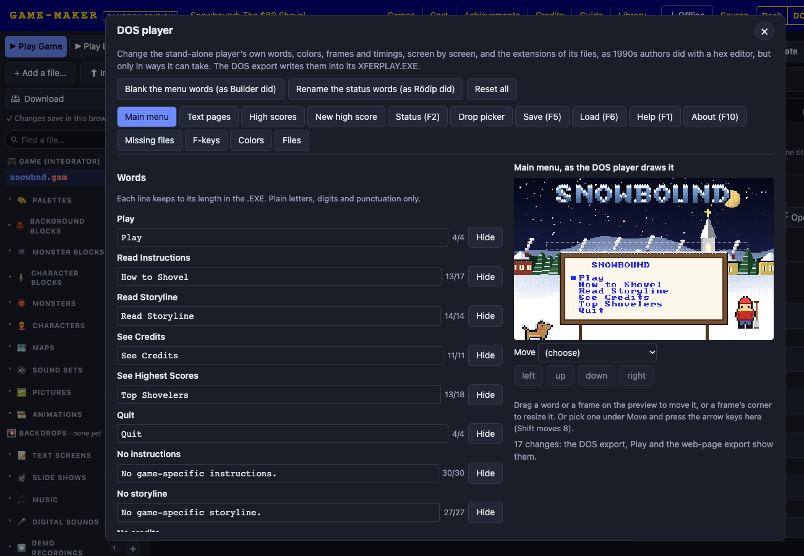

Authors in the 1990s changed the DOS player's words, colors and screens with a hex editor. The
DOS player panel does it safely, a tab for each screen: rename or hide menu words, move or
resize a frame by dragging it on the preview, and pick colors, timings, F-keys and file
extensions. The DOS export writes the changes into its `XFERPLAY.EXE`, and Play and the web
exports show them too.

## The Level check and Make a walkthrough

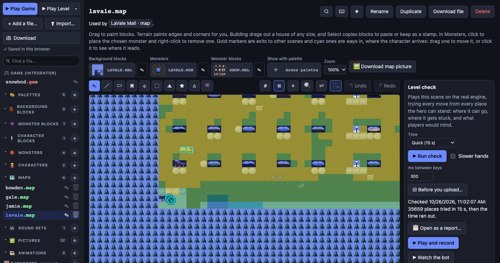

The Level check plays a scene on the real engine, trying every move from every place the hero
can stand. The heat map shows where the hero got, and it marks the places a player can get
stuck, with fixes where it knows one. The block, monster and sound editors show what it found
as badges, and the _Before you upload…_ list ticks itself off.

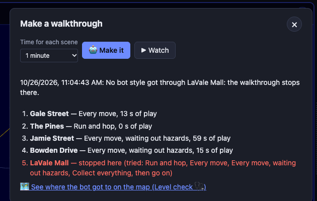

_Make a walkthrough_ sends a bot through every scene, trying quicker play styles first, and
says how far it got. Its run can be watched, or opened on the map in the Level check. Here it
stopped in LaVale Mall, the hardest level, at one minute a scene.

## Downloads

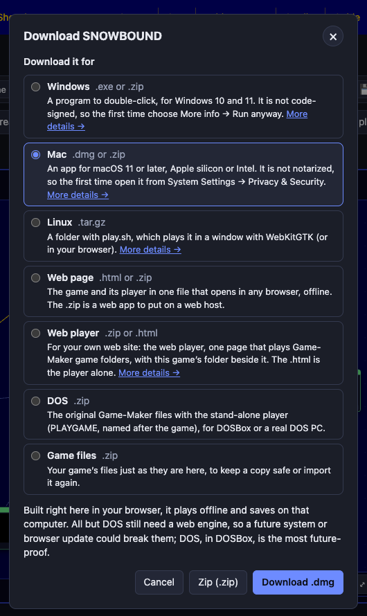

A game downloads as a Windows program, a Mac app or a Linux folder that plays in its own window;
as a one-page web game or an installable web app; as the web player for your own site; as a DOS
folder with PLAYGAME, for DOSBox or a real PC; or as its files alone. All of them are built
right in the browser.

## Imports, ratings and notes

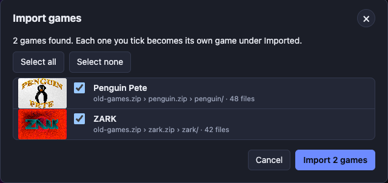

Drop folders, files, `.zip`s (zips inside zips too) or exported `.html` pages on the import
tile. Every game found inside is listed with its picture and where it came from, so a whole
archive can come in at once.

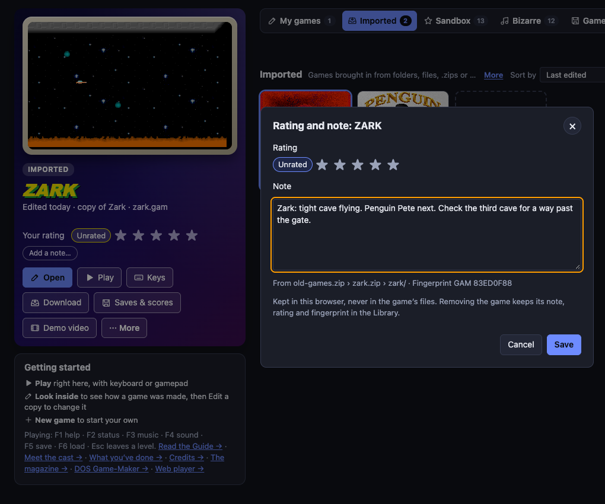

Imported games get a 1–5 star rating and a note, kept in this browser and never in the game's
files. The Library collects the notes, and a game removed and imported again gets its rating
and note back.

## The Library and the printables

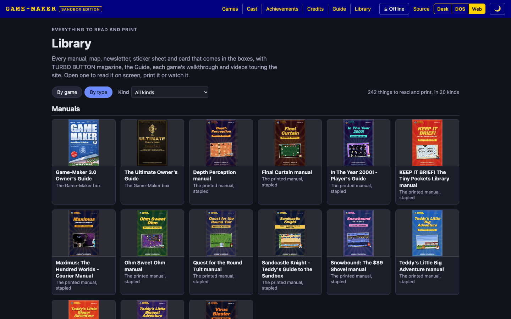

The Library holds everything to read or print: the Game-Maker box's two guides, each game's
manual, hint book, maps, newsletter, stickers and cards, the walkthroughs and the videos. Sort
it by game or by type and narrow it to one kind.

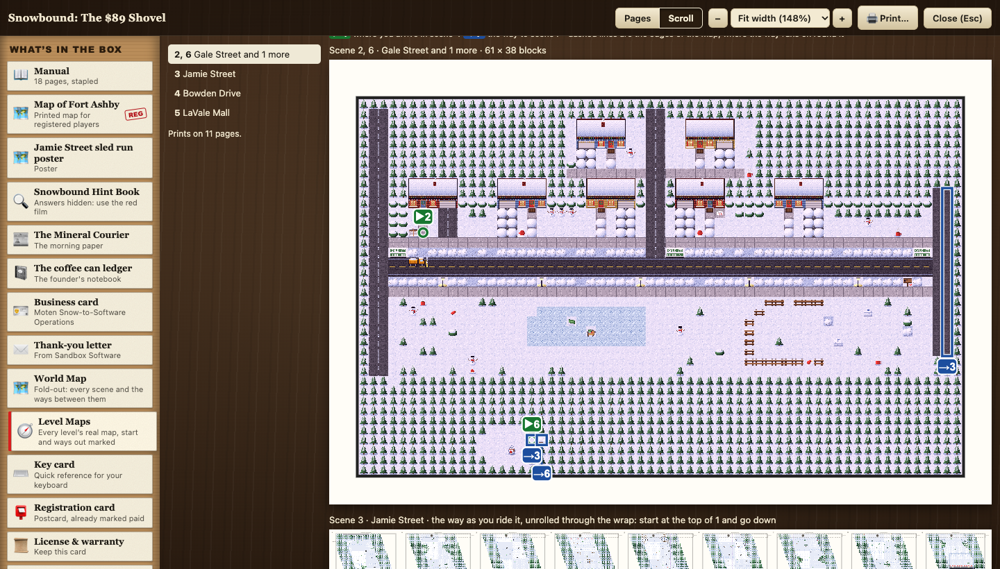

Paper opens in the box viewer, a page at a time or as one scrolling column, at any size. The
Level Maps are each level's real map, cropped to what the player sees, with the start and ways
out marked.

## The Assistant and the MCP server

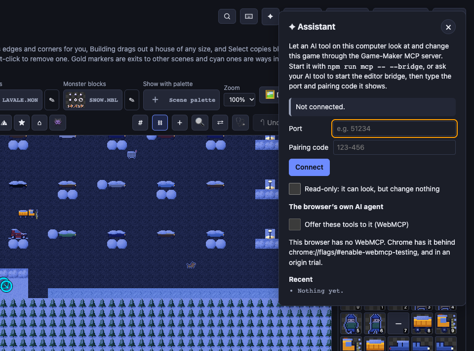

The ✦ button beside a file's title opens the Assistant, a chat with your own AI about the open
game. _AI setup_ connects it to Ollama, on this computer or another, or to any OpenAI-compatible
server; the address, model and key stay in this browser. The AI looks at the game with the same
tools the Level check and the bot use, and makes small changes and play-tests them. In _Ask
before changing_ each change waits for Apply or Skip; _Change freely_ applies them with Undo
still there, and _Read-only_ keeps it to looking. _What should I do next?_ runs the Level check, the bot
and the file checks and has the AI say what to fix first (with no AI set up, it lists what the
checks found), and the game keeps a to-do list. _Describe a game…_, for an empty game here, or
_✦ Describe it to your AI…_ in the home page's _+ New game_, builds a game from a description until the bot can win it. The picture was taken with a
scripted stand-in for a model, not a real AI.

_Use an AI tool on this computer instead (MCP)…_ at the bottom of the chat connects the open game
to the Game-Maker MCP server instead (`npm run mcp -- --bridge` in `web/`), so an AI tool such as
Claude Code can work on it, each change a step you can undo. The server also works on game
folders without the editor; see [the MCP server's README](../web/scripts/mcp/README.md).
