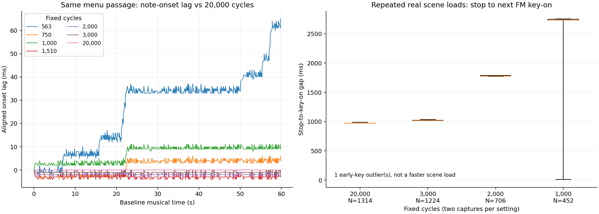
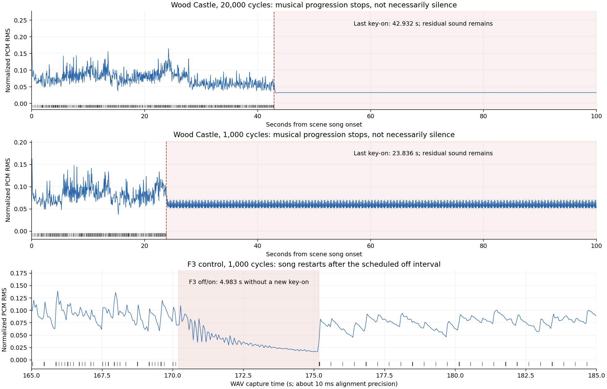

# PLAYGAME music at low DOSBox-X CPU settings: measured results

Measured November 6, 2026 (UTC), by Hermes Agent using OpenAI Codex GPT-6.1 Sol, directed by Lewis Moten. This is a measurement of the unmodified CD **PLAYGAME 3.0** in DOSBox-X, not a measurement of a physical IBM AT or PS/1.

## Verdict

**PLAYGAME does not generally stretch its music in proportion to a slow game loop.** In the matched stationary/movement tests, 1,000 cycles played at 0.99830/0.99783 of the fast baseline's rate: about **0.17%/0.22% slower**, not several times slower. However, continuity is not perfect: scene changes stop and restart the song, with median stop-to-next-key-on intervals increasing from **974 ms at 20,000 cycles to 2,735 ms at 1,000 cycles**. F3 also restarts the song. Wood Castle stops advancing after **42.93–42.99 seconds** at the three faster settings, and after only **23.835–23.836 seconds** at 1,000 cycles. There was also one long in-scene progression stall and one early-key/held-note anomaly in the original-health/scene-loop diagnostics. Thus the answer is **small ordinary tempo loss, definite restart/hold problems, and a broken song—not a universal CPU-proportional slowdown**. Residual sound often continues through a musical hold; a silence detector alone would miss it. Exact 286 MHz and physical-disk behavior remain unproved.

## Reproducible protocol and scope

Inputs:

- Harness: `feature/headless-playgame-audio`, commit `1adcc3d4c48dcd072c3e542cba307336c8ad41ce`.
- Static predictions/scenarios: `feature/playgame-music-timing-research`, commit `af1173054e22eabf1422d6589302c863ba0bc46e`, `docs/research/playgame-music-timing.md`.
- Player: `cd/gm/playgame.exe`, SHA-256 `49ed1c7898b05cd19813e1731f7694f52ee17d768f01e38991666fac86365d4b`. Player, driver and CMF bytes were not patched.
- DOSBox-X **2026.01.02 SDL2, commit 59915c1**, Ubuntu package `2026.01.02+dfsg-2`; `core=normal`, `cputype=286`, fixed cycles, SB2/OPL2 at A220 I7 D1, 48 kHz stereo PCM, both SDL dummy drivers. This is the upstream harness configuration, not a test of the earlier SBPro2/IRQ5 suggestion.
- Analysis: Python **3.14.4**, NumPy **2.3.5**; optional plots use Matplotlib **3.10.7**. All audio processing was local.

The main sweep uses 20,000/1,000/2,000/3,000 cycles. The harness names the latter three `286-6`/`286-8`/`286-12`, but **those are not calibrated MHz equivalents**. Supplemental menu runs use 563/750/1,510 cycles. The DOSBox-X CPU guide's rough 286/8 and 286/12 reference points are 750 and 1,510; 563 is merely an extrapolated lower point. The lower points were tested on the menu only. Fixed 20,000 replaces host-dependent `max`, while retaining the same 286 instruction model.

**Study accounting:** 72 attempts yielded **70 finalized, audible captures**: 54 primary captures and 16 original-health diagnostics. Two silent launches, GIF/1,000 repeat 2 and protected F3/1,000 repeat 2, never reached FM playback; they remain recorded as failures and were replaced by repeat 3 with the same inputs. Three earlier pilots are preserved separately and are not counted in the tables. Every primary cell has two valid captures; every scene-loop capture has at least 200 detected completed stop/restart pairs. Repeats test timing repeatability, not bit-identical WAVs.

The private test graphs retain Donut's original assets. They remove title/menu animation and the idle demo to isolate the menu; S3 restores an original GIF in the menu slot. S2/S9 and the final F3 control raise only the copied character's hit-point meter to 32767, preventing monster damage from ending the comparison. S4/S7 place self-links around Sand Castle's spawn, exercising real scene teardown/loading without claiming to have beaten an original level. S6 starts directly in Wood Castle at map position 40,43. No archival file in the repository was edited.

| Scenario             | Capture duration, including startup | Inputs / analysis window                                                                |
| -------------------- | ----------------------------------: | --------------------------------------------------------------------------------------- |
| S1 menu              |                               150 s | No gameplay input; first 60 s of `gentle.cmf`                                           |
| S2 stationary        |                               240 s | Enter at 90 s; first 60 s after Sand Castle music starts                                |
| S2 movement / S9 VOC |                     Same S2 capture | Right and Space held at 165–225 s; analyze that interval                                |
| S3 GIF               |                               150 s | `gentle.cmf` starts before the original GIF decodes; first 60 s                         |
| S4/S7 scene loop     |                             1,400 s | Enter at 90 s; repeated actual self-linked scene loads                                  |
| S5 F3                |                               210 s | Enter at 90 s; F3 at 170/175 s, held 600 ms; compare restarted prefix                   |
| S6 Wood Castle       |                               210 s | Enter at 90 s; observe failure for over 90 s after song onset                           |
| S8 joystick          |                             Not run | Harness has `joysticktype=none`; an absent-stick game-port timing test is not available |

ADDKEY timestamps precede WAV recording by a small launch interval, and each key adds a few milliseconds to its scheduling clock. Exact commands/configs are preserved per run. `lN` sets release duration; it does not advance the scheduled delay. PLAYGAME's `SlowKeys` sets a one-second typematic delay, allowing a 600 ms F3 hold without repeat. Original-health/shorter-key attempts are retained separately; an unrelated death or missed key is not called a music failure.

## Measurement definitions

- **Silent gap:** full-scale-normalized RMS below **0.001**, over both channels in **10 ms windows**, for at least **100 ms**. Leading startup silence is excluded. Gap edges have roughly 20 ms window uncertainty.
- **Musical hold:** absence of progressing FM writes/key-ons, or an all-notes-off to next-key-on interval. This can remain audible because of release tails or held notes. It is not interchangeable with RMS silence.
- **Tempo ratio:** inverse slope of sample onset time fitted against baseline onset time for identical, unique eight-note phrases. Tokens include OPL voice, frequency and block, plus percussion key-ons. Fits require 20 phrases spanning five seconds and reject residuals above 250 ms. A ratio below 1 means slower. No continuous tempo is assigned to the repeatedly restarting short scene-loop excerpts.
- **Segment duration:** elapsed time between first/last matched phrase starts, not BPM or full-song length. The CSV retains both baseline/sample durations and fit residuals.

DRO clocks start at the first FM key-on, not WAV zero. DOSBox-X suppresses unchanged register writes; the all-off detector therefore accepts at least four descending zero B-register writes ending at B0 within 20 ms. The original nine-write signature is not always fully present. A changed write after a gap over 30 seconds can close a DRO with an unencoded delay in its header and start another file. The analyzer preserves and flags that rollover; it does not repair headers or invent an exact stitched timeline.

## Setting × scenario results

Each cell represents two valid captures. Silent-gap counts are **run A/run B**, and the longest gap is the maximum across them. RMS windows are those above, except S4/S7, S5 and S6 use the entire capture after startup. S5 tempo uses the restarted 20-second prefix; S6 tempo uses the **pre-failure first 20 seconds**, not the frozen tail. Ratios are means, with the observed range shown where it differs at five decimals.

| Fixed cycles | Scenario             | Silent gaps A/B | Longest silent gap (ms) | Tempo ratio vs baseline [range] |
| -----------: | -------------------- | --------------: | ----------------------: | ------------------------------- |
|       20,000 | S1 menu              |             0/0 |                       0 | 1.00000                         |
|          563 | S1 menu              |             0/0 |                       0 | 0.99913                         |
|          750 | S1 menu              |             0/0 |                       0 | 0.99983                         |
|        1,000 | S1 menu              |             0/0 |                       0 | 0.99983                         |
|        1,510 | S1 menu              |             0/0 |                       0 | 1.00000                         |
|        2,000 | S1 menu              |             0/0 |                       0 | 1.00000                         |
|        3,000 | S1 menu              |             0/0 |                       0 | 1.00000                         |
|       20,000 | S2 stationary        |             0/0 |                       0 | 1.00000                         |
|        1,000 | S2 stationary        |             0/0 |                       0 | 0.99830 [0.99830–0.99831]       |
|        2,000 | S2 stationary        |             0/0 |                       0 | 0.99948 [0.99947–0.99948]       |
|        3,000 | S2 stationary        |             0/0 |                       0 | 0.99958                         |
|       20,000 | S2 movement / S9 VOC |             0/0 |                       0 | 1.00000                         |
|        1,000 | S2 movement / S9 VOC |             0/0 |                       0 | 0.99783                         |
|        2,000 | S2 movement / S9 VOC |             0/0 |                       0 | 0.99996                         |
|        3,000 | S2 movement / S9 VOC |             0/0 |                       0 | 0.99995                         |
|       20,000 | S3 GIF decode        |             0/0 |                       0 | 1.00000                         |
|        1,000 | S3 GIF decode        |             0/0 |                       0 | 0.99983                         |
|        2,000 | S3 GIF decode        |             0/0 |                       0 | 1.00000                         |
|        3,000 | S3 GIF decode        |             0/0 |                       0 | 1.00000                         |
|       20,000 | S4 / S7 scene loop   |             0/0 |                       0 | N/A (restarts)                  |
|        1,000 | S4 / S7 scene loop   |             0/1 |                     110 | N/A (restarts)                  |
|        2,000 | S4 / S7 scene loop   |             0/0 |                       0 | N/A (restarts)                  |
|        3,000 | S4 / S7 scene loop   |             0/0 |                       0 | N/A (restarts)                  |
|       20,000 | S5 F3 restart        |             0/0 |                       0 | 1.00000                         |
|        1,000 | S5 F3 restart        |             0/0 |                       0 | 0.99967 [0.99966–0.99967]       |
|        2,000 | S5 F3 restart        |             0/0 |                       0 | 0.99854 [0.99772–0.99937]       |
|        3,000 | S5 F3 restart        |             0/0 |                       0 | 0.99968                         |
|       20,000 | S6 Wood prefix       |             0/0 |                       0 | 1.00000                         |
|        1,000 | S6 Wood prefix       |             0/0 |                       0 | 0.99402 [0.99378–0.99426]       |
|        2,000 | S6 Wood prefix       |             0/0 |                       0 | 0.99749 [0.99738–0.99760]       |
|        3,000 | S6 Wood prefix       |             0/0 |                       0 | 0.99833                         |

The same identified `gentle.cmf` segment spans **59.284 s** in the baseline. Its elapsed times in the two captures are:

| Cycles | Segment seconds A / B |
| -----: | --------------------: |
| 20,000 |       59.284 / 59.284 |
|    563 |       59.348 / 59.348 |
|    750 |       59.289 / 59.289 |
|  1,000 |       59.295 / 59.289 |
|  1,510 |       59.282 / 59.282 |
|  2,000 |       59.283 / 59.283 |
|  3,000 |       59.284 / 59.284 |

These endpoint times and the all-onset regression are different estimators: millisecond register-write phase/jitter affects endpoints. They do not imply that a 1,510-cycle CPU really runs the song faster than a 20,000-cycle CPU.



## Event mapping: scene changes, F3 and VOC reads

Across **3,696** detected completed stop/restart pairs, every examined first eight key-ons matched the scene song's initial eight, rather than a mid-song continuation.

| Cycles | Completed pairs A / B | Median stop-to-key-on (ms) | Ordinary observed range (ms) | Early-key anomalies |
| -----: | --------------------: | -------------------------: | ---------------------------: | ------------------: |
| 20,000 |             657 / 657 |                        974 |                      973–988 |                   0 |
|  3,000 |             612 / 612 |                      1,024 |                  1,017–1,033 |                   0 |
|  2,000 |             353 / 353 |                      1,779 |                  1,771–1,787 |                   0 |
|  1,000 |             226 / 226 |                      2,735 |                  2,712–2,756 |                   1 |

The exceptional 1,000-cycle pair has an early key-on only **13 ms** after all-off; that is not a faster completed load. At DRO **1,316.599 s** / approximately WAV **1,327.089 s**, eight voices key on 13–26 ms after all-off. No intervening key-off clears them before the next bulk instrument reload at +2,751 ms; the last of those eight was already held for at least **2,725 ms** before that reload. Voice 0's first subsequent key-off is at +3,578 ms. This is an observed held-note/early-restart symptom consistent with P6's stop/start race, not a proven instruction-level cause or a general probability estimate. A simple first-operator-write heuristic misses it because a reset/reload precedes the early notes. The single RMS-silent interval is **WAV 1,331.010–1,331.120 s**, later in that same restart cycle—not the entire scene-load interval.

F3's scheduled five-second command separation produced actual stop-to-key-on gaps of **5,009/5,009 ms** at 20,000, **4,983/4,850 ms** at 1,000, **5,039/4,976 ms** at 2,000 and **5,010/5,008 ms** at 3,000. Input is processed on game-loop iterations, explaining why these are not exact five-second intervals. All eight protected F3 captures restart with the original first eight key-ons. Audible tails can continue during the off interval.

S2/S9 did not merely schedule an unverified sound key. A passive local Linux `IN_OPEN` observer watched the staged game directories during the second 2,000/3,000-cycle movement captures. It observed `mu05.voc` opening at approximately the scheduled 165-second attack, plus **108/172 `donuthit.voc` opens** within the movement interval. These are actual attack/damage VOC loads, not a claimed pickup walkthrough. The observer's WAV-size clock is buffered and approximate, not millisecond-accurate. Music continued through that verified VOC-load workload, with no ≥100 ms RMS gaps. This does **not** test slow physical disk transfers.

## Song failure and diagnostic outlier

Wood Castle is not correctly described as merely slower:

| Cycles | Last FM key-on after song onset, A / B (s) | No further writes before capture ended |
| -----: | -----------------------------------------: | -------------------------------------- |
| 20,000 |                            42.932 / 42.932 | Over 77 s in each capture              |
|  1,000 |                            23.836 / 23.835 | Over 96 s in each capture              |
|  2,000 |                            42.987 / 42.981 | Over 77 s in each capture              |
|  3,000 |                            42.966 / 42.967 | Over 77 s in each capture              |

The waveform remains audible while note progression ends. The source's 16-bit read of a 77,559-byte music block explains the predicted roughly 42.8-second boundary at faster settings. It does **not by itself explain the much earlier 1,000-cycle failure**. The bounded capture proves no recovery within the remaining recorded interval; it does not prove the whole game/keyboard froze or that recovery is impossible forever.

In original-health Sand Castle repeat 1 at 1,000 cycles, changed OPL writes cease for **49,551 ms**, beginning around WAV **133.2 s**, before the scheduled F3 commands. DOSBox-X splits the DRO on the next changed write; the old header retains that interval although its command stream does not. The score has notes throughout that passage (its longest inter-note gap is about 1.66 s), so this is not an intended 49-second rest. Audio remains audible. Other original-health runs undergo unscheduled scene/death restarts and some F3 inputs miss their intended state; those runs are retained as diagnostics, not used to assert a clean stationary/moving comparison. The long stall's source cause is unresolved.



## Comparison with the static predictions

| Prediction                                                         | Measured outcome                                                                                                                                                                       |
| ------------------------------------------------------------------ | -------------------------------------------------------------------------------------------------------------------------------------------------------------------------------------- |
| P1: ordinary in-scene music is timer-driven, not game-frame-driven | Supported by matched menu, GIF, stationary, movement and verified VOC-load passages. Ordinary steady loss is small; this is not a claim that every song/state works.                   |
| P2: small tick losses from busy FM bursts                          | Onset lag is step-like and small in the ordinary passages. Exact IRQ loss counts, nesting and the numerical per-loop cost model were not instrumented, so that budget is not verified. |
| P3: scene change stops/restarts, with a larger low-speed gap       | Supported. Literal silence was overstated: residual sound often bridges the stop-to-next-note interval.                                                                                |
| P4: F3 restarts from the top                                       | Verified in all eight protected controls by initial key-on identity.                                                                                                                   |
| P5: oversized Wood Castle song breaks around 42.8 s                | Supported near 43 s at 2,000/3,000/20,000 cycles; failure at 1,000 occurs earlier and needs additional diagnosis.                                                                      |
| P6: occasional held note across a scene change                     | One matching symptom observed in the second 1,000-cycle loop capture; exact race cause remains an inference.                                                                           |

## Reproduce and inspect

With the harness dependency available, set `DOSBOX_X`/`LD_LIBRARY_PATH` as in its README. Use new output directories outside the checkout:

```sh
python3 tools/dosbox-286/measure_scenarios.py /path/to/matrix \
  --scenarios menu gif sand wood loop --jobs 4
python3 tools/dosbox-286/measure_scenarios.py /path/to/controls \
  --scenarios stress toggle --jobs 2
python3 tools/dosbox-286/measure_scenarios.py /path/to/f3-controls \
  --scenarios f3 --jobs 2
python3 tools/dosbox-286/measure_scenarios.py /path/to/lower \
  --scenarios menu --cycles 563 750 1510 --jobs 2
python3 tools/dosbox-286/summarize_measurements.py \
  /path/to/matrix /path/to/controls /path/to/lower /path/to/f3-controls > results.json
python3 tools/dosbox-286/measure_audio.py /path/to/matrix/menu-1000-1 \
  --baseline /path/to/matrix/menu-20000-1 --score cd/gameware/donut/gentle.cmf
python3 -m unittest discover -s tools/dosbox-286 -v
# Optional isolated environment with Matplotlib:
python3 tools/dosbox-286/plot_measurements.py results.json /path/to/plots \
  /path/to/matrix /path/to/controls /path/to/lower /path/to/f3-controls
```

Run batches serially on a loaded host. This study overlapped batches and other Kaylee work; it uses captured PCM/DRO time, not host elapsed time. If a launch stays silent, preserve it as failed and rerun the same command to a new directory. The two replacement captures' exact 150/210-second commands and key schedules are recorded in the evidence packet. They are not substituted silently into the original records.

The companion [100-row CSV](playgame-music-286-captures.csv) contains per-capture/passage gaps, segment durations, fit residuals and WAV hashes. Full timestamped results, raw DROs, configs, failure records, VOC-open observations and plot provenance are retained in the evidence packet. **Full WAVs and listening excerpts stay in the private Kaylee reference folder**, not Git. The root task owns the final programmers-guide write-up; no existing reference document was overwritten.

## Limits and recommended fixes

- DOSBox-X cycles are an instruction-throughput setting, not exact 286 timing; the emulated PIT/OPL/card/bus are not a physical PS/1. DOS file access does not reproduce real disk rotational/sector delays. No SMARTDRV/cache A/B test, disconnected-stick game-port test, Software Simulate video comparison, alternate Sound Blaster type or older player binary was measured here. These results cannot settle whether a real PS/1 BIOS/disk/controller holds interrupts during I/O.
- Do not turn the observed VOC-load result into a physical-disk guarantee, or charge every VOC read with a proven music pause. The verified scene stop/restart boundary and music-player failures are separate phenomena.
- If correcting a future player rather than preserving DOS behavior, validate CMF sizes and every event read, use correct chunked/large-buffer reads with checked return counts, and bound offsets. This addresses the known oversized-song defect; it is not a proved fix for the earlier low-cycle stall.
- Make song-stop state changes atomic relative to the timer: clear the playable/loaded state before freeing song memory, then perform all-off/freeing with explicit ownership. Keep FM/timer servicing bounded and non-reentrant, with elapsed-tick accounting rather than unsafe nested event stepping. Instrument those paths before claiming the rare anomaly's cause or a fix.
- For seamless scene changes, preload the next scene/song outside the ISR and define whether music should continue instead of calling stop/restart around teardown. Reducing CPU-bound loading shortens the observed gap but does not remove that policy.

No gameplay, original-player or web slow-PC behavior was changed. Harness/analyzer tests and plot rendering were exercised; lint, package builds, whole-project TypeScript and related Vitest tests passed. The broader NOTICE reader check still has **12 failures for missing generated `games/*/disk/credits.txt` fixtures**, as in the harness handoff; it is not reported as green. All feature publication is branch-only after workflow-trigger inspection; no PR, merge, tag or master change is part of this measurement.
